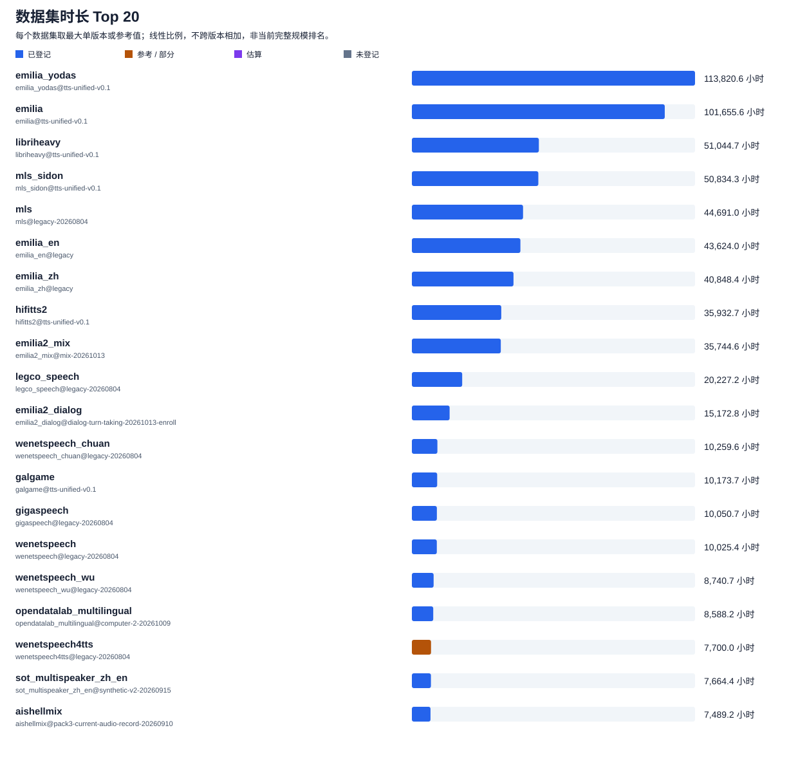

# 数据总览

按数据集查看语言、支持任务、时长和特性。清洗、热词、加噪、评测入口和训练框架配置归入所属数据集，不另算一套源数据。

当前登记 **197 个数据集条目**；另有 **20 个下载来源声明**和 **1 个训练混合配方**。登记不代表本机文件已齐备。

时长单位为小时。不同版本、子集和标注片段可能重叠，逐项列出，不相加为总量；没有时长的条目仍保留。参考表数字未核实当前文件与划分覆盖；“过滤前”不能当作清洗后时长。已被合并版本取代（`superseded_by`）的旧版本不再列出，仍可按原 ID 和版本解析。

任务是该数据集各已登记版本的能力并集，具体版本和划分以链接内声明为准。标点、热词和文件哈希校验都不能单独证明做过内容清洗。

## 数据规模与登记覆盖

每个数据集仅取最大的一项完整版本登记、参考或估算时长，并标出对应版本。部分划分和过滤前时长不参与排名；不同颜色区分登记值与参考 / 估算值。排名用于查看量级，不代表最新版本或整个数据集的完整时长。

覆盖图按数据集互斥分类：优先计入“至少一个版本有完整时长登记”，其次是“仅参考、估算或部分时长”，其余为“尚未登记”。完整登记只针对对应版本，不代表整个数据集所有子集和版本均已覆盖。

## 英文数据

| 数据集 | 语言 | 支持任务 | 时长（小时，注明范围） | 特性 / 备注 |
|---|---|---|---|---|
| [ami_ihm](../../catalog/ami_ihm.yaml#L1) | en | 语音识别 | 95.5（已登记；[hf-edinburghcstr-20261023](../../catalog/ami_ihm.yaml#L1)） | AMI 会议语料的近讲耳麦（IHM）版本：英文 16 kHz 单声道，按 Kaldi AMI s5 切句、文本大写归一化，带会议、说话人和耳麦编号。train / dev / test 分别 108502、13098、12643 句，共 95.5 小时，会议划分与 Kaldi full-corpus-ASR 一致。本机已有 AMI 单远场麦克风版 `ami_sdm`，可与这份近讲版对照近场和远场 |
| [audioset_esc_test](../../catalog/open_audio_eval.yaml#L1385) | en | 背景声场景描述 | 6.8（已登记；[eval-20260804](../../catalog/open_audio_eval.yaml#L1385)） | 当前仅登记评测入口 |
| [chime4](../../catalog/chime4.yaml#L1) | en | 语音识别 | 10.1（已登记；[hf-prummn-20261023](../../catalog/chime4.yaml#L1)） | CHiME-4 评测数据：WSJ0 句子在公交（BUS）、咖啡馆（CAF）、步行街（PED）、街道（STR）四种噪声环境下用 6 麦平板录制（real）或模拟（simu），英文 16 kHz 单声道 16 bit。这里有 dev（dt05）和 eval（et05）的 1 通道、2 通道 track 音频与全部转写，共 5920 条、10.09 小时，每组 4 个说话人；常用 1 通道 track 的 et05_real 报 WER。没有训练音频（tr05）、6 通道 track、背景噪声和 embedded 连续录音，这些属于完整 CHiME-3（LDC2017S24），公开渠道拿不到，只能评测 |
| [chime6](../../catalog/chime6.yaml#L1) | en | 语音识别、重叠语音检测、带说话人标注的语音识别、说话人分段与归属、目标说话人语音识别 | 56.3（已登记；[speaker-records-v1-20260912](../../catalog/chime6.yaml#L149)） 174.5（已登记；[turn-taking-20261014](../../catalog/amphionasr_v4.yaml#L1364)） | 家庭聚会中的多通道远场和重叠语音；包含音频、官方转写、房间布局和许可文件。 官方转写原包保留尾随字节问题；标注入口使用解压内容不变、通过 CRC 校验的修复归档；已解包、实测音频头并生成通用说话人记录；保留官方划分和标注；会议 turn-taking。整句拼成 2/3 人混合窗，时长 0.5～30 秒。注册音是窗外另一句，1～30 秒。有近场时远场:近场 = 3:1 |
| [common_voice_en](../../catalog/local_lhotse_derived.yaml#L307) | en | 语音识别、热词增强语音识别 | 1,862.7（已登记；[icefall-20260908](../../catalog/icefall_runtime.yaml#L311)） 1,862.7（已登记；[legacy-20260804](../../catalog/icefall_base.yaml#L260)） 27.2（已登记；[eval-20260804](../../catalog/open_audio_eval.yaml#L280)） 1,835.4（已登记；[clean-v1-20260805](../../catalog/local_lhotse_derived.yaml#L307)） 27.2（已登记；[eval-20260804](../../catalog/open_audio_eval.yaml#L350)） 1,835.4（已登记；[hotwords-v1-20260805](../../catalog/local_lhotse_derived.yaml#L409)） 27.2（已登记；[eval-20260804](../../catalog/open_audio_eval.yaml#L1698)） 27.2（已登记；[eval-20260804](../../catalog/open_audio_eval.yaml#L2402)） 27.2（已登记；[eval-20260804](../../catalog/open_audio_eval.yaml#L1666)） 27.2（已登记；[eval-20260804](../../catalog/open_audio_eval.yaml#L2370)） 27.2（已登记；[eval-20260804](../../catalog/open_audio_eval.yaml#L1634)） 27.2（已登记；[eval-20260804](../../catalog/open_audio_eval.yaml#L2338)） 27.2（已登记；[eval-20260804](../../catalog/open_audio_eval.yaml#L1570)） 27.2（已登记；[eval-20260804](../../catalog/open_audio_eval.yaml#L2274)） 27.2（已登记；[eval-20260804](../../catalog/open_audio_eval.yaml#L1538)） 27.2（已登记；[eval-20260804](../../catalog/open_audio_eval.yaml#L2242)） 27.2（已登记；[eval-20260804](../../catalog/open_audio_eval.yaml#L1602)） 27.2（已登记；[eval-20260804](../../catalog/open_audio_eval.yaml#L2306)） 27.2（已登记；[eval-20260804](../../catalog/open_audio_eval.yaml#L1730)） 27.2（已登记；[eval-20260804](../../catalog/open_audio_eval.yaml#L2434)） 27.2（已登记；[eval-20260804](../../catalog/open_audio_eval.yaml#L1506)） 27.2（已登记；[eval-20260804](../../catalog/open_audio_eval.yaml#L2210)） 27.2（已登记；[eval-20260804](../../catalog/open_audio_eval.yaml#L1410)） 27.2（已登记；[eval-20260804](../../catalog/open_audio_eval.yaml#L2114)） 27.2（已登记；[eval-20260804](../../catalog/open_audio_eval.yaml#L1474)） 27.2（已登记；[eval-20260804](../../catalog/open_audio_eval.yaml#L2178)） 27.2（已登记；[eval-20260804](../../catalog/open_audio_eval.yaml#L1442)） 27.2（已登记；[eval-20260804](../../catalog/open_audio_eval.yaml#L2146)） 1,854.0（[参考表](https://ccnuebbmik1f.feishu.cn/wiki/CEXFwEjPoi2bIukVjk9c5FdOn12?sheet=3d4d23)；legacy-20260804） | Qwen3-ASR-1.7B + whisper-large-v3 双引擎筛选；train 需过滤 1,127 条失败记录；test 清单尚未应用筛选结果；含派生版本（与源数据可能重叠） |
| [cs_dialogue_en](../../catalog/icefall_base.yaml#L1683) | en | 语音识别 | 26.6（已登记；[icefall-20260908](../../catalog/icefall_runtime.yaml#L2099)） 26.6（已登记；[legacy-20260804](../../catalog/icefall_base.yaml#L1683)） | 含派生版本（与源数据可能重叠） |
| [dipco](../../catalog/dipco.yaml#L1) | en | 语音识别、带说话人标注的语音识别、说话人分段与归属 | 6.5（已登记；[modelscope-benjamin-paine-20261023](../../catalog/dipco.yaml#L1)） 5.3（已登记；[zenodo-8122551-20261023](../../catalog/dipco.yaml#L81)） | DiPCo 晚宴语料：每场 4 人在家庭餐桌边自然聊天，英文 16 kHz。每人一个近讲麦克风，另有 5 台 7 麦阵列设备（U01–U05）放在房间不同位置。dev、eval 各 5 场、16 个说话人，共 7078 句、6.5 小时语音。这一版按句切好：split-channel 每句存近讲 + 35 个远场通道（25.5 万行），mixed-channel 把每台设备 7 个通道取平均（4.2 万行）；每行带 会话、说话人、设备、通道、离设备距离、性别、母语和转写。parquet 的 train/test 就是官方 dev/eval，没有训练集。有重叠语音，远场通道互相之间也有重复，统计时长时只算一遍；DiPCo 晚宴语料官方完整整场版：10 场，每场 4 个近讲麦克风 + 5 台设备 × 7 个通道 = 39 个单声道 16 kHz WAV，共 390 个文件，加官方 JSON 转写（每句带说话人、性别、母语、近讲和各设备上的起止时间）。dev、eval 各 5 场、16 个说话人，共 7078 句，会话总长 5.3 小时。用于长音频的说话人日志和多人 ASR；按句评测用已切好的 `dipco@modelscope-benjamin-paine-20261023` |
| [emilia_en](../../catalog/legacy_multilingual.yaml#L895) | en | 语音识别 | 43,624.0（已登记；[legacy](../../catalog/legacy_multilingual.yaml#L895)） | 参考表注明 clean2604，Whisper + Qwen3ASR 转录、已有清洗；本次未复核实际样本；有含标点版本 |
| [emotion1200_en](../../catalog/open_audio_eval.yaml#L1022) | en | 说话人情感分类、情感与说话风格描述、语音情感识别 | 5.2（已登记；[eval-20260804](../../catalog/open_audio_eval.yaml#L1022)） 5.2（已登记；[eval-20260804](../../catalog/open_audio_eval.yaml#L1086)） 5.2（已登记；[eval-20260804](../../catalog/open_audio_eval.yaml#L958)） | 当前仅登记评测入口 |
| [fleurs_en](../../catalog/legacy_multilingual.yaml#L826) | en | 语音识别 | 10.3（已登记；[legacy](../../catalog/legacy_multilingual.yaml#L826)） | 有含标点版本 |
| [gigaspeech](../../catalog/icefall_base.yaml#L188) | en | 语音识别 | 40.3（已登记；[eval-20260804](../../catalog/open_audio_eval.yaml#L218)） 10,050.7（已登记；[icefall-20260908](../../catalog/icefall_runtime.yaml#L229)） 10,050.7（已登记；[legacy-20260804](../../catalog/icefall_base.yaml#L188)） 10,000.0（[参考表](https://ccnuebbmik1f.feishu.cn/wiki/CEXFwEjPoi2bIukVjk9c5FdOn12?sheet=3d4d23)；legacy-20260804） | 含派生版本（与源数据可能重叠） |
| [hifitts](../../catalog/tts_unified.yaml#L452) | en | 语音识别、语音合成 | 291.7（已登记；[tts-unified-v0.1](../../catalog/tts_unified.yaml#L452)） | 音频编码字节存放在 Lance 表内；原始划分在 metadata_json.original_split，统一输出全部为 train。ASR 用 tts_lance.iter_asr_samples（tts-asr-rules/v1）读取，会排除原始 dev/test 等 |
| [hifitts2](../../catalog/tts_unified.yaml#L492) | en | 语音识别、语音合成 | 35,932.7（已登记；[tts-unified-v0.1](../../catalog/tts_unified.yaml#L492)） | 音频编码字节存放在 Lance 表内；原始划分在 metadata_json.original_split，统一输出全部为 train。ASR 用 tts_lance.iter_asr_samples（tts-asr-rules/v1）读取，会排除原始 dev/test 等 |
| [icsi](../../catalog/icsi.yaml#L1) | en | 语音识别、说话人分段与归属 | 71.7（已登记；[modelscope-argmaxinc-20261025](../../catalog/icsi.yaml#L1)） | ICSI 会议语料：伯克利 ICSI 研究所 2000–2002 年录的 75 场真实英文工作会议（每场 3–10 人，共 53 位登记说话人），71.7 小时。这一版的音频是官方的近讲混合音轨（把所有人的头戴麦叠成一路，16 kHz 单声道），每场带说话人分段（12.9 万段），适合做说话人日志评测；另附官方 MRT 原始转写（含时间、说话人）和 NXT 标注（词、分段、对话行为），可做多人会议 ASR。不含远场桌面麦通道 |
| [iemocap_ser](../../catalog/open_audio_eval.yaml#L883) | en | 语音情感识别 | 1.5（已登记；[eval-20260804](../../catalog/open_audio_eval.yaml#L883)） | 当前仅登记评测入口 |
| [legco_speech_en](../../catalog/icefall_base.yaml#L1875) | en | 语音识别 | 249.6（已登记；[icefall-20260908](../../catalog/icefall_runtime.yaml#L2289)） 249.6（已登记；[legacy-20260804](../../catalog/icefall_base.yaml#L1875)） | 含派生版本（与源数据可能重叠） |
| [libri2mix](../../catalog/open_audio_eval.yaml#L1229) | en | 目标说话人语音识别 | 8.4（已登记；[eval-20260804](../../catalog/open_audio_eval.yaml#L1229)） 8.4（已登记；[eval-20260804](../../catalog/open_audio_eval.yaml#L1333)） 8.4（已登记；[eval-20260804](../../catalog/open_audio_eval.yaml#L1281)） 11.2（已登记；[eval-20260804](../../catalog/open_audio_eval.yaml#L1150)） | 当前仅登记评测入口 |
| [libri3mix](../../catalog/open_audio_eval.yaml#L1255) | en | 目标说话人语音识别 | 10.9（已登记；[eval-20260804](../../catalog/open_audio_eval.yaml#L1255)） 10.9（已登记；[eval-20260804](../../catalog/open_audio_eval.yaml#L1359)） 10.9（已登记；[eval-20260804](../../catalog/open_audio_eval.yaml#L1307)） 16.3（已登记；[eval-20260804](../../catalog/open_audio_eval.yaml#L1176)） | 当前仅登记评测入口 |
| [libricss](../../catalog/libricss.yaml#L1) | en | 语音识别、重叠语音检测、speech_separation | 10.1（已登记；[hf-uglyducking-20261023](../../catalog/libricss.yaml#L1)） | LibriCSS：把 LibriSpeech test-clean 句子拼成约 10 分钟的“会议”，在办公室里用扬声器外放，7 麦圆形阵列录制，英文 16 kHz。6 种条件（无重叠长停顿 0L、无重叠短停顿 0S、重叠 10%–40% 的 OV10–OV40）各 10 个 session，共 60 段、10.1 小时、5023 句。每个 session 有 `record/raw_recording.wav`（7 通道录音）、`clean/` （外放源信号，`mix.wav` 单声道、`each_spk.wav` 8 通道）和 `transcription/meeting_info.txt`（起止时间、说话人、LibriSpeech 句子 ID、文本）。用于多人重叠 ASR 和语音分离评测；句子来自 LibriSpeech test-clean，不要和它一起当训练数据 |
| [libriheavy](../../catalog/tts_unified.yaml#L532) | en | 语音识别、语音合成 | 51,044.7（已登记；[tts-unified-v0.1](../../catalog/tts_unified.yaml#L532)） | 音频编码字节存放在 Lance 表内；原始划分在 metadata_json.original_split，统一输出全部为 train。ASR 用 tts_lance.iter_asr_samples（tts-asr-rules/v1）读取，会排除原始 dev/test 等 |
| [librimix](../../catalog/librimix.yaml#L156) | en | 目标说话人语音识别 | 6,921.9（已登记；[按目标样本累计混合音频，非去重语料时长](../../catalog/librimix.yaml#L156)） 6,865.5（已登记；[按目标样本累计混合音频，非去重语料时长](../../catalog/librimix.yaml#L482)） | LibriMix_960 当前训练与测试（英文小写）；纯转写、独立 enrollment/mixture、空转写负样本；LibriMix_960 当前训练与测试（英文小写）；转换输入快照，时长见通用版本；LibriMix_960 历史训练入口（保留原英文大小写）；纯转写、独立 enrollment/mixture、空转写负样本；LibriMix_960 历史训练入口（保留原英文大小写）；转换输入快照，时长见通用版本 |
| [librispeech](../../catalog/icefall_base.yaml#L1) | en | 语音识别、热词增强语音识别 | 971.6（已登记；[icefall-20260908](../../catalog/icefall_runtime.yaml#L1)） 971.6（已登记；[legacy-20260804](../../catalog/icefall_base.yaml#L1)） 5.4（已登记；[eval-20260804](../../catalog/open_audio_eval.yaml#L662)） 5.4（已登记；[eval-20260804](../../catalog/open_audio_eval.yaml#L510)） 5.3（已登记；[eval-20260804](../../catalog/open_audio_eval.yaml#L694)） 5.3（已登记；[eval-20260804](../../catalog/open_audio_eval.yaml#L542)） 10.7（已登记；[recipe-1](../../catalog/icefall_traffic_derived.yaml#L1)） 10.7（已登记；[recipe-1](../../catalog/icefall_traffic_derived.yaml#L247)） 10.7（已登记；[recipe-1](../../catalog/icefall_traffic_derived.yaml#L370)） 10.7（已登记；[recipe-1](../../catalog/icefall_traffic_derived.yaml#L493)） 10.7（已登记；[recipe-1](../../catalog/icefall_traffic_derived.yaml#L124)） 960.0（[参考表](https://ccnuebbmik1f.feishu.cn/wiki/CEXFwEjPoi2bIukVjk9c5FdOn12?sheet=3d4d23)；legacy-20260804） | 含派生版本（与源数据可能重叠） |
| [libritts_r](../../catalog/tts_unified.yaml#L572) | en | 语音识别、语音合成 | 583.1（已登记；[tts-unified-v0.1](../../catalog/tts_unified.yaml#L572)） | 音频编码字节存放在 Lance 表内；原始划分在 metadata_json.original_split，统一输出全部为 train。ASR 用 tts_lance.iter_asr_samples（tts-asr-rules/v1）读取，会排除原始 dev/test 等 |
| [ljspeech](../../catalog/tts_unified.yaml#L612) | en | 语音识别、语音合成 | 23.9（已登记；[tts-unified-v0.1](../../catalog/tts_unified.yaml#L612)） | 音频编码字节存放在 Lance 表内；原始划分在 metadata_json.original_split，统一输出全部为 train。ASR 用 tts_lance.iter_asr_samples（tts-asr-rules/v1）读取，会排除原始 dev/test 等 |
| [meld_ser](../../catalog/open_audio_eval.yaml#L852) | en | 语音情感识别 | 2.3（已登记；[eval-20260804](../../catalog/open_audio_eval.yaml#L852)） | 当前仅登记评测入口 |
| [mls](../../catalog/icefall_base.yaml#L116) | en | 语音识别 | 15.5（已登记；[eval-20260804](../../catalog/open_audio_eval.yaml#L249)） 44,691.0（已登记；[icefall-20260908](../../catalog/icefall_runtime.yaml#L147)） 44,691.0（已登记；[legacy-20260804](../../catalog/icefall_base.yaml#L116)） 44,500.0（[参考表](https://ccnuebbmik1f.feishu.cn/wiki/CEXFwEjPoi2bIukVjk9c5FdOn12?sheet=3d4d23)；legacy-20260804） | 含派生版本（与源数据可能重叠） |
| [msp_podcast_ser](../../catalog/open_audio_eval.yaml#L914) | en | 语音情感识别 | 未登记 | 当前仅登记评测入口 |
| [notsofar](../../catalog/icefall_runtime.yaml#L2988) | en | 语音识别、连续语音分离、重叠语音检测、带说话人标注的语音识别、说话人分段与归属 | 200.0（估算；[hf-ba8fd0f034ce-sim-v1.5-200h](../../catalog/multilingual_multispeaker.yaml#L416)） 176.9（已登记；[单远场麦克风标注片段](../../catalog/icefall_runtime.yaml#L2988)） | 标注片段时长，重叠语音或多麦克风可能重复计时 |
| [singapore_english](../../catalog/icefall_base.yaml#L371) | en | 语音识别 | 3.9（已登记；[icefall-20260908](../../catalog/icefall_runtime.yaml#L429)） 3.9（已登记；[legacy-20260804](../../catalog/icefall_base.yaml#L371)） 2.0（[参考表](https://ccnuebbmik1f.feishu.cn/wiki/CEXFwEjPoi2bIukVjk9c5FdOn12?sheet=3d4d23)；legacy-20260804） | 新加坡英语；登记 cleaned 标注，尚未核实清洗引擎和规则；含派生版本（与源数据可能重叠） |
| [singaporean](../../catalog/icefall_base.yaml#L332) | en | 语音识别 | 0.1（已登记；[icefall-20260908](../../catalog/icefall_runtime.yaml#L393)） 0.1（已登记；[legacy-20260804](../../catalog/icefall_base.yaml#L332)） 0.2（[参考表](https://ccnuebbmik1f.feishu.cn/wiki/CEXFwEjPoi2bIukVjk9c5FdOn12?sheet=3d4d23)；legacy-20260804） | 新加坡英语；登记 cleaned 标注，尚未核实清洗引擎和规则；含派生版本（与源数据可能重叠） |
| [tal100_en](../../catalog/icefall_base.yaml#L427) | en | 语音识别 | 4.8（已登记；[icefall-20260908](../../catalog/icefall_runtime.yaml#L488)） 4.8（已登记；[legacy-20260804](../../catalog/icefall_base.yaml#L427)） | 含派生版本（与源数据可能重叠） |
| [vctk](../../catalog/tts_unified.yaml#L765) | en | 语音识别、语音合成 | 82.7（已登记；[tts-unified-v0.1](../../catalog/tts_unified.yaml#L765)） | 音频编码字节存放在 Lance 表内；原始划分在 metadata_json.original_split，统一输出全部为 train。ASR 用 tts_lance.iter_asr_samples（tts-asr-rules/v1）读取，会排除原始 dev/test 等 |
| [voicebank_demand](../../catalog/voicebank_demand.yaml#L1) | en | speech_enhancement | 10.0（已登记；[hf-jacoblincool-16k-20261023](../../catalog/voicebank_demand.yaml#L1)） | VoiceBank-DEMAND 语音增强标准集：VCTK 朗读句子加 DEMAND 等噪声，每条有带噪和干净两份等长音频，英文。原始 48 kHz，这份镜像降到 16 kHz。train 28 个说话人 11572 对 9.4 小时，test 2 个说话人 824 对 0.6 小时。只有音频 ID，没有转写；用于增强、去噪评测（PESQ、STOI 等），不用于 ASR |
| [voices](../../catalog/voices.yaml#L1) | en | 语音识别 | 27.9（已登记；[hf-prummn-20261023](../../catalog/voices.yaml#L1)） | VOiCES 远场评测子集：LibriSpeech 句子在 4 个真实房间里用扬声器外放、同时放干扰声（多人 babble、音乐、电视或无干扰），由近处（mc01）和远处（mc05）麦克风录下，英文 16 kHz 单声道。共 6400 条、27.9 小时、100 个说话人，每个“房间 × 干扰 × 麦克风”组合 200 条，带小写转写（metadata 的 answer 字段）。只是 devkit 测试集的抽样，不是全量。 句子来自 LibriSpeech，不要和 LibriSpeech 一起当训练数据 |

## 中文及粤语数据

| 数据集 | 语言 | 支持任务 | 时长（小时，注明范围） | 特性 / 备注 |
|---|---|---|---|---|
| [3dspeaker](../../catalog/3dspeaker.yaml#L1) | zh | 说话人身份识别、声纹验证 | 1,275.3（已登记；[speaker-records-v1-20260912](../../catalog/3dspeaker.yaml#L120)） | 跨设备、距离和方言声纹数据；包含三个官方验证配对清单，转写只覆盖普通话；已解包、实测音频头并生成通用说话人记录；保留官方划分和标注 |
| [OpenSLR 159 AISHELL-5](../../catalog/zh_dialogue.yaml#L350) | zh | 语音识别、带说话人标注的语音识别 | 445.4（已登记；[far-mic-v1-20261010](../../catalog/zh_dialogue.yaml#L350)） | 含派生版本（与源数据可能重叠） |
| [aidatatang](../../catalog/zh_source_clean.yaml#L327) | zh | 语音识别、热词增强语音识别 | 145.3（已登记；[clean-dual-qwen-moss-v1-20261008](../../catalog/zh_source_clean.yaml#L327)） 145.5（已登记；[icefall-20260908](../../catalog/icefall_runtime.yaml#L1606)） 145.5（已登记；[legacy-20260804](../../catalog/icefall_base.yaml#L1228)） 145.5（已登记；[hotwords-v1-20260805](../../catalog/local_lhotse_derived.yaml#L927)） 140.0（[参考表](https://ccnuebbmik1f.feishu.cn/wiki/CEXFwEjPoi2bIukVjk9c5FdOn12?sheet=3d4d23)；legacy-20260804） | aidatatang@icefall-20260908 的全部监督片段（上游称 train，实为含官方 dev/test 说话人的全量，故登记为 all），经 Qwen3-ASR-1.7B 与 MOSS-Transcribe-Diarize 双引擎一致性清洗；逐条写入 custom.clean（pass、reason、action、engine_status），不删除记录，读取时按 require_clean_pass 过滤。音频沿用源版本，不复制。规则 consensus-v6 / wenetspeech-faithful-v5：pass 236834、reject 431。少于 2 个字的 too_short 共 251 条按规则不经引擎直接 pass。用于合成时建议在 pass 之外再要求：两引擎均有效、MOSS 只输出 1 个说话人、action 不是 review_consensus；too_short 另要求两引擎规范化后与原文完全一致。按此筛选保留 220726 条、134.34 小时（too_short 通过 144/251）；含派生版本（与源数据可能重叠） |
| [aishell](../../catalog/icefall_base.yaml#L697) | zh | 语音识别、热词增强语音识别 | 10.0（已登记；[eval-20260804](../../catalog/open_audio_eval.yaml#L1)） 179.0（已登记；[icefall-20260908](../../catalog/icefall_runtime.yaml#L1005)） 179.0（已登记；[legacy-20260804](../../catalog/icefall_base.yaml#L697)） 10.0（已登记；[clean-v1-20260805](../../catalog/local_lhotse_derived.yaml#L600)） 10.0（已登记；[eval-20260804](../../catalog/open_audio_eval.yaml#L414)） 160.9（已登记；[hotwords-v1-20260805](../../catalog/local_lhotse_derived.yaml#L647)） 155.0（[参考表](https://ccnuebbmik1f.feishu.cn/wiki/CEXFwEjPoi2bIukVjk9c5FdOn12?sheet=3d4d23)；legacy-20260804） | 含派生版本（与源数据可能重叠） |
| [aishell2](../../catalog/icefall_base.yaml#L769) | zh | 语音识别、热词增强语音识别 | 4.0（已登记；[eval-20260804](../../catalog/open_audio_eval.yaml#L32)） 1,004.8（已登记；[icefall-20260908](../../catalog/icefall_runtime.yaml#L1087)） 1,004.8（已登记；[legacy-20260804](../../catalog/icefall_base.yaml#L769)） 4.0（已登记；[clean-v1-20260805](../../catalog/local_lhotse_derived.yaml#L718)） 4.0（已登记；[eval-20260804](../../catalog/open_audio_eval.yaml#L446)） 4.0（已登记；[hotwords-v1-20260805](../../catalog/local_lhotse_derived.yaml#L764)） 1,036.0（[参考表](https://ccnuebbmik1f.feishu.cn/wiki/CEXFwEjPoi2bIukVjk9c5FdOn12?sheet=3d4d23)；legacy-20260804） | 含派生版本（与源数据可能重叠） |
| [aishell3](../../catalog/zh_source_clean.yaml#L166) | zh | 语音识别、热词增强语音识别、语音合成 | 63.1（已登记；[clean-dual-qwen-moss-v1-20261008](../../catalog/zh_source_clean.yaml#L166)） 22.4（已登记；[eval-20260804](../../catalog/open_audio_eval.yaml#L63)） 85.6（已登记；[icefall-20260908](../../catalog/icefall_runtime.yaml#L1140)） 85.6（已登记；[legacy-20260804](../../catalog/icefall_base.yaml#L824)） 85.6（已登记；[tts-unified-v0.1](../../catalog/tts_unified.yaml#L1)） 22.4（已登记；[eval-20260804](../../catalog/open_audio_eval.yaml#L478)） 85.6（已登记；[hotwords-v1-20260805](../../catalog/local_lhotse_derived.yaml#L810)） 65.0（[参考表](https://ccnuebbmik1f.feishu.cn/wiki/CEXFwEjPoi2bIukVjk9c5FdOn12?sheet=3d4d23)；legacy-20260804） | aishell3@icefall-20260908 的 train 监督片段，经 Qwen3-ASR-1.7B 与 MOSS-Transcribe-Diarize 双引擎一致性清洗；逐条写入 custom.clean（pass、reason、action、engine_status），不删除记录，读取时按 require_clean_pass 过滤。音频沿用源版本，不复制。规则 consensus-v6 / wenetspeech-faithful-v5：pass 63219、reject 43。少于 2 个字的 too_short 共 1982 条按规则不经引擎直接 pass。用于合成时建议在 pass 之外再要求：两引擎均有效、MOSS 只输出 1 个说话人、action 不是 review_consensus；too_short 另要求两引擎规范化后与原文完全一致。按此筛选保留 57965 条、57.77 小时（too_short 通过 1898/1982）；音频编码字节存放在 Lance 表内；原始划分在 metadata_json.original_split，统一输出全部为 train。ASR 用 tts_lance.iter_asr_samples（tts-asr-rules/v1）读取，会排除原始 dev/test 等；含派生版本（与源数据可能重叠） |
| [aishell4](../../catalog/amphionasr_v4.yaml#L262) | zh | 语音识别、说话人分段与归属、目标说话人语音识别 | 12.7（已登记；[diarization-benchmark-v1-20261021](../../catalog/diarization_benchmark.yaml#L1)） 119.5（已登记；[icefall-20260908](../../catalog/icefall_runtime.yaml#L1199)） 28.4（已登记；[legacy-20260804](../../catalog/icefall_base.yaml#L879)） 322.3（已登记；[turn-taking-20261014](../../catalog/amphionasr_v4.yaml#L1)） 66.9（已登记；[turn-taking-20261014-utts](../../catalog/ts_window_utts.yaml#L115)） | 会议普通转写。每条 supervision 一条，时长 0.5～30 秒，文本非空。多通道只取第 0 路；Frozen local evaluation slice; audio and RTTM bytes copied unchanged. Not a claim of official release equivalence or training disjointness.；会议 turn-taking。整句拼成 2/3 人混合窗，时长 0.5～30 秒。注册音是窗外另一句，1～30 秒。有近场时远场:近场 = 3:1；aishell4@turn-taking-20261014 的 train 划分（不含 eval/test），时间线取自 aishell4@icefall-20260908 的 train 人工标注。加 metadata.window_utts（窗口内每句的说话人与相对混合起点的起止，取自来源标注并截到窗口，截断的标 clipped）与同一命名空间的 metadata.target_speaker，供 open-audio-llm 帧级说话人活动标签（objective.ts_activity_weight）；其余字段不变，音频引用改指本版本，音频索引与原版逐行相同。正样本的目标语句与转写逐字一致（忽略空白和标点；窗口边缘截断的句子允许只转写一部分）才写时间线，负样本只有注册人确实不在窗口里说话才写；其余记录不写时间线（不出帧级标签）。负样本中注册人按标注其实在窗口内说话的记录 ID 列在 excluded-records-<split>.txt，训练配方用 exclude_records 排除。生成脚本 audio-data-contract scripts/ts_robust/add_window_utts.py，逐划分统计见 report.json；含派生版本（与源数据可能重叠） |
| [aishell4_meeting_sot](../../catalog/similar_voice.yaml#L2) | zh | 带说话人标注的语音识别 | 377.5（已登记；[meeting-channel-view-v2-20261010](../../catalog/zh_farfield.yaml#L1)） | aishell4_meeting_sot@real-meetings-v2-20261010 的“音色相近”子集：每个训练窗口里最相近两位说话人的声纹余弦相似度，各划分（窗口长度）取前 1/3。声纹模型 ERes2NetV2（iic/speech_eres2netv2_sv_zh-cn_16k-common），每人取不与他人重叠的语音（片段 ≥0.3 秒，合计 ≥1.5 秒，最多 10 秒）；30/300/600 秒窗口用对应 120 秒窗口里同一说话人的声纹均值。少于两个有声纹说话人的窗口不入选。标注不改，记录逐行照抄源版本，音频仍指向源版本。源版本训练排除名单里的记录（选模留出集、目标为空窗口）已剔除。用途：下一轮训练额外加采相近音色的窗口 |
| [aishell5_meeting_sot](../../catalog/similar_voice.yaml#L398) | zh | 带说话人标注的语音识别 | 未登记 | aishell5_meeting_sot@far-mic-v1-20261010 的“音色相近”子集：每个训练窗口里最相近两位说话人的声纹余弦相似度，各划分（窗口长度）取前 1/3。声纹模型 ERes2NetV2（iic/speech_eres2netv2_sv_zh-cn_16k-common），每人取不与他人重叠的语音（片段 ≥0.3 秒，合计 ≥1.5 秒，最多 10 秒）；30/300/600 秒窗口用对应 120 秒窗口里同一说话人的声纹均值。少于两个有声纹说话人的窗口不入选。标注不改，记录逐行照抄源版本，音频仍指向源版本。源版本训练排除名单里的记录（选模留出集、目标为空窗口）已剔除。用途：下一轮训练额外加采相近音色的窗口 |
| [aishellmix](../../catalog/aishellmix.yaml#L380) | zh | 目标说话人语音识别 | 6,733.1（已登记；[按目标样本累计混合音频，非去重语料时长](../../catalog/aishellmix.yaml#L380)） 7,489.2（已登记；[按目标样本累计混合音频，非去重语料时长](../../catalog/aishellmix.yaml#L114)） | AISHELLMix 原版历史训练（enrollment 至少 2 秒）与项目测试数据；纯转写、独立 enrollment/mixture、空转写负样本；AISHELLMix 原版历史训练（enrollment 至少 2 秒）与项目测试数据；转换输入快照，时长见通用版本；AISHELLMix pack3 当前与历史等价训练数据；纯转写、独立 enrollment/mixture、空转写负样本；AISHELLMix pack3 当前与历史等价训练数据；转换输入快照，时长见通用版本 |
| [alimeeting](../../catalog/diarization_benchmark.yaml#L69) | zh | 语音识别、连续语音分离、重叠语音检测、带说话人标注的语音识别、说话人分段与归属、目标说话人语音识别 | 10.8（已登记；[diarization-benchmark-v1-20261021](../../catalog/diarization_benchmark.yaml#L69)） 10.0（已登记；[diarization-benchmark-v1-20261021-2023test](../../catalog/diarization_benchmark.yaml#L137)） 125.5（已登记；[openslr-119-far-local-20260903](../../catalog/alimeeting_far_raw.yaml#L1)） 157.9（已登记；[openslr-119-local-20260826](../../catalog/multilingual_multispeaker.yaml#L1)） 157.9（已登记；[单远场麦克风标注片段](../../catalog/icefall_runtime.yaml#L2832)） 427.7（已登记；[turn-taking-20261014](../../catalog/amphionasr_v4.yaml#L377)） 82.7（已登记；[turn-taking-20261014-utts](../../catalog/ts_window_utts.yaml#L1)） | Frozen local evaluation slice; audio and RTTM bytes copied unchanged. Not a claim of official release equivalence or training disjointness.；远场会议、多说话人、重叠语音；训练集 8 条标注越界，使用前需处理；会议普通转写。每条 supervision 一条，时长 0.5～30 秒，文本非空。多通道只取第 0 路；标注片段时长，重叠语音或多麦克风可能重复计时；会议 turn-taking。整句拼成 2/3 人混合窗，时长 0.5～30 秒。注册音是窗外另一句，1～30 秒。有近场时远场:近场 = 3:1；alimeeting_sdm@turn-taking-20261014 的 train 划分（不含 eval/test），时间线取自 alimeeting_sdm@icefall-20260908 的 train 人工标注。加 metadata.window_utts（窗口内每句的说话人与相对混合起点的起止，取自来源标注并截到窗口，截断的标 clipped）与同一命名空间的 metadata.target_speaker，供 open-audio-llm 帧级说话人活动标签（objective.ts_activity_weight）；其余字段不变，音频引用改指本版本，音频索引与原版逐行相同。正样本的目标语句与转写逐字一致（忽略空白和标点；窗口边缘截断的句子允许只转写一部分）才写时间线，负样本只有注册人确实不在窗口里说话才写；其余记录不写时间线（不出帧级标签）。负样本中注册人按标注其实在窗口内说话的记录 ID 列在 excluded-records-<split>.txt，训练配方用 exclude_records 排除。生成脚本 audio-data-contract scripts/ts_robust/add_window_utts.py，逐划分统计见 report.json；含派生版本（与源数据可能重叠） |
| [alimeeting_near_farsim_meeting_sot](../../catalog/zh_farfield.yaml#L167) | zh | 带说话人标注的语音识别 | 399.5（已登记；[near-farsim-v1-20261009](../../catalog/zh_farfield.yaml#L167)） | 已登记划分：train_120s、train_300s、train_30s、train_600s |
| [alimeeting_sdm_meeting_sot](../../catalog/similar_voice.yaml#L134) | zh | 带说话人标注的语音识别 | 327.3（已登记；[meeting-channel-view-v2-20261010](../../catalog/zh_farfield.yaml#L84)） | alimeeting_sdm_meeting_sot@real-meetings-v2-20261010 的“音色相近”子集：每个训练窗口里最相近两位说话人的声纹余弦相似度，各划分（窗口长度）取前 1/3。声纹模型 ERes2NetV2（iic/speech_eres2netv2_sv_zh-cn_16k-common），每人取不与他人重叠的语音（片段 ≥0.3 秒，合计 ≥1.5 秒，最多 10 秒）；30/300/600 秒窗口用对应 120 秒窗口里同一说话人的声纹均值。少于两个有声纹说话人的窗口不入选。标注不改，记录逐行照抄源版本，音频仍指向源版本。源版本训练排除名单里的记录（选模留出集、目标为空窗口）已剔除。用途：下一轮训练额外加采相近音色的窗口 |
| [biic_podcast_ser](../../catalog/open_audio_eval.yaml#L790) | zh | 语音情感识别 | 22.6（已登记；[eval-20260804](../../catalog/open_audio_eval.yaml#L790)） | 当前仅登记评测入口 |
| [business_feedback](../../catalog/business_feedback.yaml#L1) | zh | 目标说话人语音识别 | 0.0（已登记；[ts-20261010](../../catalog/business_feedback.yaml#L1)） 0.0（已登记；[ts-20261012](../../catalog/business_feedback.yaml#L63)） 0.0（已登记；[ts-20261016](../../catalog/business_feedback.yaml#L125)） 0.0（已登记；[ts-20261019](../../catalog/business_feedback.yaml#L207)） 0.0（已登记；[ts-20261021](../../catalog/business_feedback.yaml#L269)） 0.1（已登记；[ts-20261022](../../catalog/business_feedback.yaml#L311)） | 业务反馈的目标说话人 bad case，每个批次一个版本，只用于评测，不进训练。测试人员在办公室注册一个人的声纹，同时用 pad 播放干扰声（歌曲、对白）时反馈的 7 个调试包（8 段输入）。 每段输入为 3 秒注册音频加一个识别片段；7 个包使用同一段注册音频；业务反馈的目标说话人 bad case，每个批次一个版本，只用于评测，不进训练。测试人员把设备放在一个环境里持续收音，定时查看结果，反馈的 5 个调试包（case-08 到 case-12）。 每段输入为 3 秒注册音频加一个识别片段；与第一批使用同一段注册音频；业务反馈的目标说话人 bad case，每个批次一个版本，只用于评测，不进训练。测试人员持续收音时反馈的 31 个调试包（表格第 2–37 行，去掉与第二批重复的包），与第二批使用同一段注册音频。 每段输入为 3 秒注册音频加一个识别片段；目标是否在场与参考文本经复核人逐条听音确认；业务反馈的目标说话人 bad case，每个批次一个版本，只用于评测，不进训练。测试人员持续收音时反馈的 2 个调试包（表格第 38、39 行），换了一段新的注册音频。 每段输入为 3 秒注册音频加一个识别片段；目标是否在场取自表格的错误类型，在场那条的参考文本由自动复核确定，未经人工听审；业务反馈的目标说话人 bad case，每个批次一个版本，只用于评测，不进训练。测试人员持续收音时反馈的 2 个调试包（表格第 40、41 行），换了一段新的注册音频。 每段输入为 3 秒注册音频加一个识别片段；两条都是机主未说话、另一个人说了一句约 1 秒的短话，模型输出了这句话；业务反馈的目标说话人 bad case，每个批次一个版本，只用于评测，不进训练。用户直接提供的两段长录音（没有调试包），机主全程未说话，旁边外放电视剧对白，期望输出为空； 按 25 秒连续分窗，每窗一条，共 10 条；注册录音 8.28 秒整段保存，客户端取前 5 秒 |
| [childmandarin](../../catalog/icefall_base.yaml#L1434) | zh | 语音识别 | 41.0（已登记；[icefall-20260908](../../catalog/icefall_runtime.yaml#L1842)） 41.0（已登记；[legacy-20260804](../../catalog/icefall_base.yaml#L1434)） | 含派生版本（与源数据可能重叠） |
| [cnceleb1](../../catalog/cnceleb1.yaml#L1) | zh | 说话人身份识别、声纹验证 | 270.1（已登记；[speaker-records-v1-20260912](../../catalog/cnceleb1.yaml#L58)） | 中文跨场景声纹数据，修正版 v2；train 对应官方 dev，test 对应官方 eval；已解包、实测音频头并生成通用说话人记录；保留官方划分和标注 |
| [cnceleb2](../../catalog/cnceleb2.yaml#L1) | zh | 说话人身份识别、声纹验证 | 1,084.3（已登记；[speaker-records-v1-20260912](../../catalog/cnceleb2.yaml#L78)） | 中文跨场景声纹训练数据，修正版 v2；三个分包按 aa、ab、ac 顺序构成同一个 tar.gz；已解包、实测音频头并生成通用说话人记录；保留官方划分和标注 |
| [common_voice_zh](../../catalog/icefall_base.yaml#L1297) | zh | 语音识别、热词增强语音识别 | 76.1（已登记；[icefall-20260908](../../catalog/icefall_runtime.yaml#L1678)） 76.1（已登记；[legacy-20260804](../../catalog/icefall_base.yaml#L1297)） 17.5（已登记；[eval-20260804](../../catalog/open_audio_eval.yaml#L318)） 17.5（已登记；[clean-v1-20260805](../../catalog/local_lhotse_derived.yaml#L482)） 17.5（已登记；[eval-20260804](../../catalog/open_audio_eval.yaml#L382)） 60.0（已登记；[hotwords-v1-20260805](../../catalog/local_lhotse_derived.yaml#L529)） 17.4（已登记；[eval-20260804](../../catalog/open_audio_eval.yaml#L2050)） 17.4（已登记；[eval-20260804](../../catalog/open_audio_eval.yaml#L2754)） 17.4（已登记；[eval-20260804](../../catalog/open_audio_eval.yaml#L2018)） 17.4（已登记；[eval-20260804](../../catalog/open_audio_eval.yaml#L2722)） 17.4（已登记；[eval-20260804](../../catalog/open_audio_eval.yaml#L1986)） 17.4（已登记；[eval-20260804](../../catalog/open_audio_eval.yaml#L2690)） 17.4（已登记；[eval-20260804](../../catalog/open_audio_eval.yaml#L1922)） 17.4（已登记；[eval-20260804](../../catalog/open_audio_eval.yaml#L2626)） 17.4（已登记；[eval-20260804](../../catalog/open_audio_eval.yaml#L1890)） 17.4（已登记；[eval-20260804](../../catalog/open_audio_eval.yaml#L2594)） 17.4（已登记；[eval-20260804](../../catalog/open_audio_eval.yaml#L1954)） 17.4（已登记；[eval-20260804](../../catalog/open_audio_eval.yaml#L2658)） 17.4（已登记；[eval-20260804](../../catalog/open_audio_eval.yaml#L2082)） 17.4（已登记；[eval-20260804](../../catalog/open_audio_eval.yaml#L2786)） 17.4（已登记；[eval-20260804](../../catalog/open_audio_eval.yaml#L1858)） 17.4（已登记；[eval-20260804](../../catalog/open_audio_eval.yaml#L2562)） 17.4（已登记；[eval-20260804](../../catalog/open_audio_eval.yaml#L1762)） 17.4（已登记；[eval-20260804](../../catalog/open_audio_eval.yaml#L2466)） 17.4（已登记；[eval-20260804](../../catalog/open_audio_eval.yaml#L1826)） 17.4（已登记；[eval-20260804](../../catalog/open_audio_eval.yaml#L2530)） 17.4（已登记；[eval-20260804](../../catalog/open_audio_eval.yaml#L1794)） 17.4（已登记；[eval-20260804](../../catalog/open_audio_eval.yaml#L2498)） 43.0（[参考表](https://ccnuebbmik1f.feishu.cn/wiki/CEXFwEjPoi2bIukVjk9c5FdOn12?sheet=3d4d23)；legacy-20260804） | 含派生版本（与源数据可能重叠） |
| [common_voice_zh_hk](../../catalog/icefall_base.yaml#L2087) | yue | 语音识别 | 25.3（已登记；[icefall-20260908](../../catalog/icefall_runtime.yaml#L2497)） 25.3（已登记；[legacy-20260804](../../catalog/icefall_base.yaml#L2087)） | 含派生版本（与源数据可能重叠） |
| [context_correction_zh](../../catalog/context_correction_zh.yaml#L1) | zh | 语音识别、目标说话人语音识别 | 17.6（已登记；[v1-20261018](../../catalog/context_correction_zh.yaml#L1)） | 上下文纠偏评测集，只用于评测，不进训练。说话人在同一段话里用说明或语境确定了某个同音词的写法 (显式说字、同名一致性、隐式语义)，识别结果应按上下文写。题目由 qwen3.6-plus 生成、 deepseek-v4-pro 独立复核，Qwen3-TTS 用测试划分说话人的声音合成，SenseVoiceSmall 拼音级质检； 另有从 WenetSpeech 播客挖掘的真实录音。生成脚本 scripts/context_correction/ |
| [csemotions](../../catalog/tts_unified.yaml#L41) | zh | 语音合成 | 10.2（已登记；[tts-unified-v0.1](../../catalog/tts_unified.yaml#L41)） | 音频编码字节存放在 Lance 表内；原始划分在 metadata_json.original_split，统一输出全部为 train。ASR 用 tts_lance.iter_asr_samples（tts-asr-rules/v1）读取，会排除原始 dev/test 等 |
| [emilia2_zh_dialogue_diarize](../../catalog/emilia2_zh_dialogue_diarize.yaml#L288) | zh | 语音识别、diarization、带说话人标注的语音识别 | 3,167.4（已登记；[hotwords-qwen3.8-flash-m4a64k-v1](../../catalog/emilia2_zh_dialogue_diarize.yaml#L288)） | 对 emilia2_zh_dialogue_diarize@moss-transcribe-diarize-0.9B-m4a64k 窗口合并后的每句转写， 用通用大模型抽取热词（人名、地名、机构、专有名词），每次 20 句、按录音内相邻句分组， 结果逐句写回；经规则过滤（单字、纯英文碎片、常见国名、长于 12 字）。 前后两段用了不同模型：b000–b020（1,710,408 句）用阿里 qwen3.8-flash；阿里账号欠费后， b021–b046（2,084,494 句）改用火山 doubao-seed-2-1-turbo-260628，提示词相同。 在 300 句开发集上 doubao 精确率 0.79、召回 0.70，qwen3.8-flash 为 0.87、0.74（参照由 qwen 输出生成，偏向 qwen）； 有热词的句子占比 qwen 段 20.9%、doubao 段 18.1%。文件里不区分行来自哪个模型，按批次号区分。 hotwords.jsonl.gz 每行 {id, hotwords}，id 对应窗口合并 supervisions 的句 id；842 句未标（hotwords 缺失）， 其中 234 句是 qwen 段内容审核拒绝，608 句是 doubao 段重试后仍失败。 句级旁路文件，按窗口使用时需同时排除 speaker_merge 窗口；Emilia2 解包数据中 m4a-64k 子集的中文对话（≥120 秒，源 46,615 条 / 3,895 h）的说话人日志伪标签； moss-transcribe-diarize-0.9B 版本只覆盖 m4a-128k 子集，两者录音不重叠，可以一起用。 流程与该版本相同：本地 MOSS-Transcribe-Diarize 0.9B 粗筛（≥2 人且每人 ≥5 秒，保留 43,877 条 / 3,720.4 h）并整条打说话人和文本； 在停顿处切成 30–120 秒窗口（149,199 个 / 3,715.4 h），按窗口整体保留或丢弃：Qwen3-ASR 整窗识别，文字差异 ≤ 15%（不计重叠处，丢 48.8 h）； 与 Emilia2 自带的带时间短句比对说话人，上游同一人被拆到其他编号的比例 ≤ 0.2（丢 45.0 h）；120 秒内无停顿等其他原因丢 19.4 h， 剩 144,774 个 / 3,602.0 h。规则和门槛沿用 128k 版本的校准与听审结论，没有重新校准（同一来源、同类节目，只是码率不同）。 与 128k 版本不同，被并人检查标记的窗口（一个 MOSS 说话人覆盖两个及以上 Emilia2 原始说话人）导出时已经剔除， 共 6,130 个 / 161.1 h，各说话人数档丢 3.0–6.5%；训练不需要再排除。 音频引用解包后转成的 16 kHz 单声道 FLAC（完整解码 m4a，不补零不截断），记录按 cut_id + start/duration 引用，不需要 ffmpeg。 约 3.3% 的记录最后一句的结束时间比音频末尾晚（MOSS 时间戳），几乎都在 0.1 秒以内，最多的两条晚 0.8 秒和 9.9 秒；128k 版本也有同样现象。 已知局限：约 10.7% 的窗口只有一个说话人；有声剧、短剧中一人配多角时 MOSS 可能按角色拆成多个说话人。 与 emilia2@tts-unified-v0.1 同源，可按 recording_id 对应；如需留验证/测试集，请两边一起排除；替代 moss-transcribe-diarize-0.9B：同一批 m4a-128k 中文对话录音、同样的 30–120 秒窗口，两个版本不要一起用。 MOSS Pro 质量抽检显示本地 0.9B 在 ≥4 个说话人的窗口上偏弱（好窗口 4 人约 74%、5 人及以上 51–60%）， 因此把上一版本保留窗口中本地标出 ≥4 人的 28,834 个 / 778.2 h 按窗口片段送 MOSS Pro（moss-transcribe-diarize-pro）重标， 再过同样的整窗文字核对（Qwen3-ASR，CER ≤ 15%，不计重叠）和说话人检查（Emilia2 自带短句，split ≤ 0.2）： 27,762 个 / 749.4 h 换成 Pro 标注；521 个 / 13.5 h 未通过而丢弃；551 个 / 15.3 h Pro 没有结果（多为安全策略拒绝），沿用本地标注。 Pro 常把本地多出来的说话人合并：本地 4 人的窗口中 3,396 个 Pro 判为 3 人、411 个判为 2 人（听审确认过本地把同一人拆成多人的例子）。 被并人检查标记的窗口（一个说话人覆盖两个及以上 Emilia2 原始说话人）导出时已经剔除，按最终标注重算，共 11,155 个 / 306.7 h （本地标注 8,813 个，与上一版本的排除名单一致；Pro 标注 2,342 个），训练不需要再排除。 结果 209,816 条 / 5,483.6 h，其中 Pro 标注 25,420 条 / 682.6 h；上一版本排除并人窗口后是 210,726 条 / 5,508.2 h。 记录里不区分标注来源，逐窗口的来源（labels_from）在运行目录 export/window-merge-v6/。 音频引用解包后转成的 16 kHz 单声道 FLAC，记录按 cut_id + start/duration 引用，不需要 ffmpeg； 约 11% 的记录窗口末尾超出 FLAC 末尾，最多 0.6 毫秒（上一版本同样）。 已知局限：约 16.8% 的窗口只有一个说话人；有声剧、短剧中一人配多角时可能按角色拆成多个说话人； 10 题听审中多人重叠处 Pro 并不比本地明显更好（两边都会漏标对方标出的重叠）。 与 emilia2@tts-unified-v0.1 同源，可按 recording_id 对应；如需留验证/测试集，请两边一起排除；Emilia2 中文多人对话说话人日志伪标签的“音色相近”子集：先剔除源版本训练排除名单 train_120s-speaker-merge-excluded-records.txt （10,766 个 MOSS 把两人并成一人的窗口），其余窗口按最相近两位说话人的 ERes2NetV2 声纹余弦相似度取前 1/3。每人取不与他人重叠的语音（片段 ≥0.3 秒，合计 ≥1.5 秒，最多 10 秒）；少于两个有声纹说话人的窗口（含单人窗口）不入选。标注不改，记录逐行照抄源版本，音频仍指向源版本（解包 m4a，读取需要 ffmpeg）。用途：下一轮训练额外加采相近音色的窗口 |
| [emilia2_zh_overlap_farsim](../../catalog/emilia2_zh_overlap_farsim.yaml#L2) | zh | 带说话人标注的语音识别 | 未登记 | 由 emilia2_zh_dialogue_diarize@moss-transcribe-diarize-0.9B 的 2–3 人 120 秒窗口（排除 ≥4 人名单）重排生成的重叠远场多人对话：逐句从原窗口单声道剪出，与他人相距 < 0.02 秒（含原本重叠）的句子保持原相对时间作为整块，其余按说话人连续段提前造成重叠（窗口目标重叠率 0.15 + 0.35·Beta(2,2)，单处重叠 ≤ 较短一段的 80%），并把短应答放进对方长段内；每位说话人在同一真实房间（SLR28）不同测点卷积，MUSAN 噪声 0–20 dB。实测重叠率均值 0.23（p10/p50/p90 0.14/0.22/0.35），实测 < 0.12 的窗口不收（80,465 个，多为独白或大段整块）。文字与说话人沿用 MOSS 0.9B 伪标签（试跑以 MOSS Pro 为参照文字错误率约 3%），时间戳按重排后更新。试跑难度核对：zh-emilia2-6000 / MOSS 0.9B 不计复读 cpER 34.4 / 25.6（AliMeeting dev 为 20.8 / 15.6）。只用于训练 |
| [emilia_zh](../../catalog/legacy_multilingual.yaml#L2335) | zh | 语音识别 | 23,956.0（已登记；[icefall-20260908](../../catalog/icefall_runtime.yaml#L975)） 40,848.4（已登记；[legacy](../../catalog/legacy_multilingual.yaml#L2335)） 23,956.0（已登记；[legacy-20260804](../../catalog/icefall_base.yaml#L665)） 23,956.0（[参考表](https://ccnuebbmik1f.feishu.cn/wiki/CEXFwEjPoi2bIukVjk9c5FdOn12?sheet=3d4d23)；legacy-20260804） | 参考表注明 clean2604，Whisper + Qwen3ASR 转录、已有清洗；本次未复核实际样本；有含标点版本；含派生版本（与源数据可能重叠） |
| [emotion1200_zh](../../catalog/open_audio_eval.yaml#L1054) | zh | 说话人情感分类、情感与说话风格描述、语音情感识别 | 4.9（已登记；[eval-20260804](../../catalog/open_audio_eval.yaml#L1054)） 4.9（已登记；[eval-20260804](../../catalog/open_audio_eval.yaml#L1118)） 4.9（已登记；[eval-20260804](../../catalog/open_audio_eval.yaml#L990)） | 当前仅登记评测入口 |
| [fleurs_zh](../../catalog/legacy_multilingual.yaml#L2266) | zh | 语音识别 | 14.1（已登记；[icefall-20260908](../../catalog/icefall_runtime.yaml#L1888)） 14.1（已登记；[legacy](../../catalog/legacy_multilingual.yaml#L2266)） 14.1（已登记；[legacy-20260804](../../catalog/icefall_base.yaml#L1481)） | 有含标点版本；含派生版本（与源数据可能重叠） |
| [hi_mia](../../catalog/hi_mia.yaml#L1) | zh | 说话人身份识别、声纹验证 | 533.6（已登记；[speaker-records-v1-20260912](../../catalog/hi_mia.yaml#L100)） | 固定中文唤醒词的远场声纹验证；使用修复损坏音频的 test_v2，含官方同人/异人配对答案；已解包、实测音频头并生成通用说话人记录；保留官方划分和标注 |
| [kespeech](../../catalog/zh_asr_eval.yaml#L160) | zh | 语音识别、热词增强语音识别 | 31.1（已登记；[eval-20260804](../../catalog/open_audio_eval.yaml#L125)） 4.2（已登记；[eval-southwestern-20261012](../../catalog/zh_asr_eval.yaml#L160)） 1,434.8（已登记；[icefall-20260908](../../catalog/icefall_runtime.yaml#L1494)） 1,434.8（已登记；[legacy-20260804](../../catalog/icefall_base.yaml#L1136)） 31.1（已登记；[clean-v1-20260805](../../catalog/local_lhotse_derived.yaml#L85)） 31.1（已登记；[hotwords-v1-20260805](../../catalog/local_lhotse_derived.yaml#L128)） 1,428.0（[参考表](https://ccnuebbmik1f.feishu.cn/wiki/CEXFwEjPoi2bIukVjk9c5FdOn12?sheet=3d4d23)；legacy-20260804） | 含派生版本（与源数据可能重叠） |
| [legco_speech](../../catalog/icefall_base.yaml#L1844) | yue | 语音识别 | 20,227.2（已登记；[icefall-20260908](../../catalog/icefall_runtime.yaml#L2259)） 20,227.2（已登记；[legacy-20260804](../../catalog/icefall_base.yaml#L1844)） | 含派生版本（与源数据可能重叠） |
| [m3ed_ser](../../catalog/open_audio_eval.yaml#L821) | zh | 语音情感识别 | 1.7（已登记；[eval-20260804](../../catalog/open_audio_eval.yaml#L821)） | 当前仅登记评测入口 |
| [magicdata](../../catalog/zh_source_clean.yaml#L496) | zh | 语音识别、热词增强语音识别 | 711.0（已登记；[clean-dual-qwen-moss-v1-20261008](../../catalog/zh_source_clean.yaml#L496)） 28.1（已登记；[eval-20260804](../../catalog/open_audio_eval.yaml#L94)） 754.7（已登记；[icefall-20260908](../../catalog/icefall_runtime.yaml#L1348)） 754.7（已登记；[legacy-20260804](../../catalog/icefall_base.yaml#L999)） 711.9（已登记；[hotwords-v1-20260805](../../catalog/local_lhotse_derived.yaml#L175)） 747.0（[参考表](https://ccnuebbmik1f.feishu.cn/wiki/CEXFwEjPoi2bIukVjk9c5FdOn12?sheet=3d4d23)；legacy-20260804） | magicdata@icefall-20260908 的 train 监督片段，经 Qwen3-ASR-1.7B 与 MOSS-Transcribe-Diarize 双引擎一致性清洗；逐条写入 custom.clean（pass、reason、action、engine_status），不删除记录，读取时按 require_clean_pass 过滤。音频沿用源版本，不复制。规则 consensus-v6 / wenetspeech-faithful-v5：pass 572637、reject 841。少于 2 个字的 too_short 共 241 条按规则不经引擎直接 pass。用于合成时建议在 pass 之外再要求：两引擎均有效、MOSS 只输出 1 个说话人、action 不是 review_consensus；too_short 另要求两引擎规范化后与原文完全一致。按此筛选保留 525329 条、644.54 小时（too_short 通过 136/241）；含派生版本（与源数据可能重叠） |
| [magicdata_ramc](../../catalog/amphionasr_v4.yaml#L3130) | zh | 语音识别、说话人分段与归属、目标说话人语音识别 | 125.0（已登记；[clean-dual-qwen-moss-v1-20261008](../../catalog/zh_source_clean.yaml#L659)） 20.6（已登记；[diarization-benchmark-v1-20261021](../../catalog/diarization_benchmark.yaml#L273)） 150.7（已登记；[icefall-20260908](../../catalog/icefall_runtime.yaml#L1430)） 150.7（已登记；[legacy-20260804](../../catalog/icefall_base.yaml#L1071)） 403.5（已登记；[turn-taking-20261014](../../catalog/amphionasr_v4.yaml#L2857)） 41.5（已登记；[turn-taking-20261014-utts](../../catalog/ts_window_utts.yaml#L341)） | 会议普通转写。每条 supervision 一条，时长 0.5～30 秒，文本非空。多通道只取第 0 路；magicdata_ramc@icefall-20260908 的 train 监督片段，经 Qwen3-ASR-1.7B 与 MOSS-Transcribe-Diarize 双引擎一致性清洗；逐条写入 custom.clean（pass、reason、action、engine_status），不删除记录，读取时按 require_clean_pass 过滤。音频沿用源版本，不复制。规则 consensus-v6 / wenetspeech-faithful-v5：pass 166711、reject 1753。少于 2 个字的 too_short 共 16573 条按规则不经引擎直接 pass。用于合成时建议在 pass 之外再要求：两引擎均有效、MOSS 只输出 1 个说话人、action 不是 review_consensus；too_short 另要求两引擎规范化后与原文完全一致。按此筛选保留 122956 条、88.85 小时（too_short 通过 10332/16573）；Frozen local evaluation slice; audio and RTTM bytes copied unchanged. Not a claim of official release equivalence or training disjointness.；会议 turn-taking。整句拼成 2/3 人混合窗，时长 0.5～30 秒。注册音是窗外另一句，1～30 秒。有近场时远场:近场 = 3:1；magicdata_ramc@turn-taking-20261014 的 train 划分（不含 eval/test），时间线取自 magicdata_ramc@icefall-20260908 的 train 人工标注。加 metadata.window_utts（窗口内每句的说话人与相对混合起点的起止，取自来源标注并截到窗口，截断的标 clipped）与同一命名空间的 metadata.target_speaker，供 open-audio-llm 帧级说话人活动标签（objective.ts_activity_weight）；其余字段不变，音频引用改指本版本，音频索引与原版逐行相同。正样本的目标语句与转写逐字一致（忽略空白和标点；窗口边缘截断的句子允许只转写一部分）才写时间线，负样本只有注册人确实不在窗口里说话才写；其余记录不写时间线（不出帧级标签）。负样本中注册人按标注其实在窗口内说话的记录 ID 列在 excluded-records-<split>.txt，训练配方用 exclude_records 排除。生成脚本 audio-data-contract scripts/ts_robust/add_window_utts.py，逐划分统计见 report.json；含派生版本（与源数据可能重叠） |
| [magicdata_ramc_farsim_meeting_sot](../../catalog/zh_farfield.yaml#L251) | zh | 带说话人标注的语音识别 | 566.6（已登记；[ramc-v2-farsim-v1-20261010](../../catalog/zh_farfield.yaml#L251)） | 已登记划分：train_120s、train_300s、train_30s、train_600s |
| [magicdata_ramc_meeting_sot](../../catalog/similar_voice.yaml#L267) | zh | 带说话人标注的语音识别 | 未登记 | magicdata_ramc_meeting_sot@real-meetings-v2-20261010 的“音色相近”子集：每个训练窗口里最相近两位说话人的声纹余弦相似度，各划分（窗口长度）取前 1/3。声纹模型 ERes2NetV2（iic/speech_eres2netv2_sv_zh-cn_16k-common），每人取不与他人重叠的语音（片段 ≥0.3 秒，合计 ≥1.5 秒，最多 10 秒）；30/300/600 秒窗口用对应 120 秒窗口里同一说话人的声纹均值。少于两个有声纹说话人的窗口不入选。标注不改，记录逐行照抄源版本，音频仍指向源版本。源版本训练排除名单里的记录（选模留出集、目标为空窗口）已剔除。用途：下一轮训练额外加采相近音色的窗口 |
| [mdcc](../../catalog/icefall_base.yaml#L1906) | yue | 语音识别 | 73.6（已登记；[icefall-20260908](../../catalog/icefall_runtime.yaml#L2319)） 73.6（已登记；[legacy-20260804](../../catalog/icefall_base.yaml#L1906)） 11.0（已登记；[icefall-20260908](../../catalog/icefall_runtime.yaml#L3913)） 11.0（已登记；[recipe-1](../../catalog/icefall_traffic_derived.yaml#L68)） 11.0（已登记；[icefall-20260908](../../catalog/icefall_runtime.yaml#L4115)） 11.0（已登记；[recipe-1](../../catalog/icefall_traffic_derived.yaml#L314)） 11.0（已登记；[icefall-20260908](../../catalog/icefall_runtime.yaml#L4216)） 11.0（已登记；[recipe-1](../../catalog/icefall_traffic_derived.yaml#L437)） 11.0（已登记；[icefall-20260908](../../catalog/icefall_runtime.yaml#L4317)） 11.0（已登记；[recipe-1](../../catalog/icefall_traffic_derived.yaml#L560)） 11.0（已登记；[icefall-20260908](../../catalog/icefall_runtime.yaml#L4014)） 11.0（已登记；[recipe-1](../../catalog/icefall_traffic_derived.yaml#L191)） | 含派生版本（与源数据可能重叠） |
| [mir1k](../../catalog/mir1k.yaml#L1) | zh | noise | 2.2（已登记；[modelscope-20261017](../../catalog/mir1k.yaml#L1)） | MIR-1K：1000 段中文流行歌卡拉 OK 片段（3–12 秒，共 2.22 小时），16 kHz 双声道 16 bit，左声道伴奏、右声道人声；`Wavfile/` 是切好的片段，`Lyrics/` 是 Big5 编码的歌词。两个声道相加即带伴奏的歌（近似外放的歌曲），只用于评测里「只有歌声、没有人说话」的场景 |
| [police_asr_unified](../../catalog/police_asr_unified.yaml#L1) | zh | 语音识别 | 805.6（已登记；[v1-20261009](../../catalog/police_asr_unified.yaml#L1)） | 警务合成语音统合版：V1-V6 全部批次合并为 train/dev/test 三个集合，不复制音频 |
| [police_terms_single](../../catalog/police_terms_single.yaml#L2) | zh | 语音识别 | 1.7（已登记；[v1-20261022](../../catalog/police_terms_single.yaml#L2)） | 警务术语单说测试集，只用于评测，不进训练。每条录音只说一个警务术语，不带句子；参考文本就是术语， supervision 的 custom.target_terms 为该术语（评测器据此报术语命中率）。术语取自警言警语 V6.0 术语表 （police_synthetic_zh_accent@legacy-rebalance-100k-20260916 source_entries 中 term/app 两类，共 1,088 个）， 每个术语 3 个说话人。Qwen3-TTS-12Hz-1.7B-Base 克隆原警务测试集的 test 口音说话人（参考音频为本机找回的原片段， 参考文本用 Qwen3-ASR 重新转写），全部是带口音的普通话。起因：实测单说术语时命中率很低，而现有警务测试集几乎都是整句 （police_asr_unified@v1-20261009 test 47,006 条里只有 9 条是单说术语） |
| [police_terms_single_train](../../catalog/police_terms_single_train.yaml#L2) | zh | 语音识别 | 11.7（已登记；[v1-20261023](../../catalog/police_terms_single_train.yaml#L2)） | 警务术语单说训练集：每条录音只说一个警务术语，不带句子；文本就是术语，supervision 的 custom.target_terms 为该术语。 术语取自警言警语 V6.0 术语表（police_synthetic_zh_accent@legacy-rebalance-100k-20260916 source_entries 中 term/app 两类，共 1,088 个，全部使用，不按旧的术语划分留出），每个术语 20 个不同说话人。 Qwen3-TTS-12Hz-1.7B-Base 克隆原警务数据的 train 口音说话人（不含粤语、不用 dev/test 说话人；参考音频为本机找回的原片段， 参考文本用 Qwen3-ASR 重新转写），全部是带口音的普通话。起因：实测单说术语时命中率很低， police_asr_unified@v1-20261009 train 里单说术语只有 2,065 条、1.11 h |
| [primewords](../../catalog/zh_source_clean.yaml#L1) | zh | 语音识别 | 98.4（已登记；[clean-dual-qwen-moss-v1-20261008](../../catalog/zh_source_clean.yaml#L1)） 99.0（已登记；[icefall-20260908](../../catalog/icefall_runtime.yaml#L1642)） 99.0（已登记；[legacy-20260804](../../catalog/icefall_base.yaml#L1266)） | primewords@icefall-20260908 的 train 监督片段，经 Qwen3-ASR-1.7B 与 MOSS-Transcribe-Diarize 双引擎一致性清洗；逐条写入 custom.clean（pass、reason、action、engine_status），不删除记录，读取时按 require_clean_pass 过滤。音频沿用源版本，不复制。规则 consensus-v6 / wenetspeech-faithful-v5：pass 50119、reject 265。少于 2 个字的 too_short 共 12 条按规则不经引擎直接 pass。用于合成时建议在 pass 之外再要求：两引擎均有效、MOSS 只输出 1 个说话人、action 不是 review_consensus；too_short 另要求两引擎规范化后与原文完全一致。按此筛选保留 41860 条、82.06 小时（too_short 通过 4/12）；含派生版本（与源数据可能重叠） |
| [realman](../../catalog/icefall_runtime.yaml#L3107) | zh | 语音识别 | 83.7（已登记；[已准备标注片段](../../catalog/icefall_runtime.yaml#L3107)） | 标注片段时长，重叠语音或多麦克风可能重复计时 |
| [realman_zh_far_asr](../../catalog/zh_farfield.yaml#L335) | zh | 语音识别 | 64.0（已登记；[zh-far-replay-v1-20261009](../../catalog/zh_farfield.yaml#L335)） | 已登记划分：train |
| [speechio](../../catalog/zh_asr_eval.yaml#L60) | zh | 语音识别 | 63.8（已登记；[eval-original-20261011](../../catalog/zh_asr_eval.yaml#L60)） 63.8（已登记；[legacy](../../catalog/legacy_multilingual.yaml#L2374)） | 有含标点版本 |
| [tal100_zh](../../catalog/icefall_base.yaml#L1369) | zh | 语音识别 | 5.5（已登记；[icefall-20260908](../../catalog/icefall_runtime.yaml#L1760)） 5.5（已登记；[legacy-20260804](../../catalog/icefall_base.yaml#L1369)） | 含派生版本（与源数据可能重叠） |
| [thchs30](../../catalog/icefall_base.yaml#L927) | zh | 语音识别、热词增强语音识别 | 6.3（已登记；[eval-20260804](../../catalog/open_audio_eval.yaml#L156)） 34.2（已登记；[icefall-20260908](../../catalog/icefall_runtime.yaml#L1266)） 34.2（已登记；[legacy-20260804](../../catalog/icefall_base.yaml#L927)） 25.5（已登记；[hotwords-v1-20260805](../../catalog/local_lhotse_derived.yaml#L881)） 35.0（[参考表](https://ccnuebbmik1f.feishu.cn/wiki/CEXFwEjPoi2bIukVjk9c5FdOn12?sheet=3d4d23)；legacy-20260804） | 含派生版本（与源数据可能重叠） |
| [threed_speaker_zh_far_asr](../../catalog/zh_farfield.yaml#L497) | zh | 语音识别 | 71.2（已登记；[zh-far-replay-clean-v1-20261010](../../catalog/zh_farfield.yaml#L497)） 75.5（已登记；[zh-far-replay-v1-20261009](../../catalog/zh_farfield.yaml#L459)） | 已登记划分：train |
| [ts_asr_benchmark](../../catalog/ts_asr_benchmark.yaml#L1) | zh | 目标说话人语音识别 | 25.0（已登记；[v1-20261013](../../catalog/ts_asr_benchmark.yaml#L1)） 26.9（已登记；[v2-20261013](../../catalog/ts_asr_benchmark.yaml#L1227)） 43.9（已登记；[v3-20261013](../../catalog/ts_asr_benchmark.yaml#L2533)） 46.5（已登记；[v4-20261022](../../catalog/ts_asr_benchmark.yaml#L4759)） | 目标说话人 ASR 评测集：由 AISHELL-3、KeSpeech、MagicData、AISHELL-2、AISHELL-1 的官方 test 划分合成，覆盖注册音频劣化、目标说话人进场离场与缺席、纯噪声、环境与设备。只用于评测，不进训练。场景见 scripts/ts_benchmark/recipe.yaml |
| [ts_asr_dev](../../catalog/ts_asr_dev.yaml#L1) | zh | 目标说话人语音识别 | 10.7（已登记；[v1-20261017](../../catalog/ts_asr_dev.yaml#L1)） | 目标说话人 ASR 评测集：由 AISHELL-3、KeSpeech、MagicData、AISHELL-2、AISHELL-1 的官方 test 划分合成，覆盖注册音频劣化、目标说话人进场离场与缺席、纯噪声、环境与设备。只用于评测，不进训练。场景见 scripts/ts_benchmark/recipe.yaml |
| [ts_asr_enroll_len](../../catalog/ts_asr_enroll_len.yaml#L1) | zh | 目标说话人语音识别 | 1.5（已登记；[v1-20261020](../../catalog/ts_asr_enroll_len.yaml#L1)） | 目标说话人 ASR 评测集：由 AISHELL-3、KeSpeech、MagicData、AISHELL-2、AISHELL-1 的官方 test 划分合成，覆盖注册音频劣化、目标说话人进场离场与缺席、纯噪声、环境与设备。只用于评测，不进训练。场景见 scripts/ts_benchmark/recipe.yaml |
| [ts_asr_farfield](../../catalog/ts_asr_farfield.yaml#L1) | zh | 目标说话人语音识别 | 5.1（已登记；[v1-20261014](../../catalog/ts_asr_farfield.yaml#L1)） 5.1（已登记；[v2-20261022](../../catalog/ts_asr_farfield.yaml#L307)） | 目标说话人 ASR 评测集：由 AISHELL-3、KeSpeech、MagicData、AISHELL-2、AISHELL-1 的官方 test 划分合成，覆盖注册音频劣化、目标说话人进场离场与缺席、纯噪声、环境与设备。只用于评测，不进训练。场景见 scripts/ts_benchmark/recipe.yaml |
| [ts_asr_handover](../../catalog/ts_asr_handover.yaml#L1) | zh | 目标说话人语音识别 | 3.8（已登记；[v1-20261020](../../catalog/ts_asr_handover.yaml#L1)） 3.8（已登记；[v2-20261022](../../catalog/ts_asr_handover.yaml#L227)） | 目标说话人 ASR 评测集：由 AISHELL-3、KeSpeech、MagicData、AISHELL-2、AISHELL-1 的官方 test 划分合成，覆盖注册音频劣化、目标说话人进场离场与缺席、纯噪声、环境与设备。只用于评测，不进训练。场景见 scripts/ts_benchmark/recipe.yaml |
| [ts_asr_nearfar](../../catalog/ts_asr_nearfar.yaml#L1) | zh | 目标说话人语音识别 | 6.0（已登记；[v1-20261014](../../catalog/ts_asr_nearfar.yaml#L1)） 6.0（已登记；[v2-20261022](../../catalog/ts_asr_nearfar.yaml#L504)） 6.0（已登记；[v3-20261022](../../catalog/ts_asr_nearfar.yaml#L1488)） | AliMeeting 测试集窗口的近场与远场对照：同一窗口、同一条注册语句，注册取远场或说话人的头戴麦，混合取远场通道 0 或各头戴麦之和（电平对齐远场混合）。基于 ts_asr_real@v2-20261013 的 AliMeeting 窗口。只用于评测，不进训练；ts_asr_nearfar@v1-20261014 的修正版，窗口和混合音频不变：每条记录加注册前 3 秒里他人说话的秒数（labels.enroll_others_s），不少于 0.3 秒的记为注册含他人声（enroll_condition = others_speech）并移入同名加 -enrollmix 的划分；生成脚本 scripts/ts_real/enroll_overlap.py；ts_asr_nearfar@v2-20261022 的 5 秒注册版，窗口和混合音频不变：注册与其 ts_asr_real@v4-20261022 源样本同样的语句片段（远场取通道 0，近场取本人头戴麦），共存 10 秒；他人说话秒数按前 5 秒计，不少于 0.3 秒的在 -enrollmix 划分。生成脚本 scripts/ts_real/enroll_long.py |
| [ts_asr_nearshort](../../catalog/ts_asr_nearshort.yaml#L1) | zh | 目标说话人语音识别 | 1.0（已登记；[v1-20261021](../../catalog/ts_asr_nearshort.yaml#L1)） 2.5（已登记；[v2-20261022](../../catalog/ts_asr_nearshort.yaml#L127)） 2.5（已登记；[v3-20261022](../../catalog/ts_asr_nearshort.yaml#L393)） | 目标说话人 ASR 评测集：由 AISHELL-3、KeSpeech、MagicData、AISHELL-2、AISHELL-1 的官方 test 划分合成，覆盖注册音频劣化、目标说话人进场离场与缺席、纯噪声、环境与设备。只用于评测，不进训练。场景见 scripts/ts_benchmark/recipe.yaml |
| [ts_asr_noise](../../catalog/ts_asr_noise.yaml#L1) | zh | 目标说话人语音识别 | 5.9（已登记；[v1-20261013](../../catalog/ts_asr_noise.yaml#L1)） 5.9（已登记；[v2-20261022](../../catalog/ts_asr_noise.yaml#L367)） | 目标说话人 ASR 评测集：由 AISHELL-3、KeSpeech、MagicData、AISHELL-2、AISHELL-1 的官方 test 划分合成，覆盖注册音频劣化、目标说话人进场离场与缺席、纯噪声、环境与设备。只用于评测，不进训练。场景见 scripts/ts_benchmark/recipe.yaml |
| [ts_asr_playback](../../catalog/ts_asr_playback.yaml#L1) | zh | 目标说话人语音识别 | 3.4（已登记；[v1-20261022](../../catalog/ts_asr_playback.yaml#L1)） | 目标说话人 ASR 评测集：由 AISHELL-3、KeSpeech、MagicData、AISHELL-2、AISHELL-1 的官方 test 划分合成，覆盖注册音频劣化、目标说话人进场离场与缺席、纯噪声、环境与设备。只用于评测，不进训练。场景见 scripts/ts_benchmark/recipe.yaml |
| [ts_asr_real](../../catalog/ts_asr_real.yaml#L1073) | zh | 目标说话人语音识别 | 6.2（已登记；[dev-v1-20261017](../../catalog/ts_asr_real.yaml#L1073)） 12.0（已登记；[overlap-v1-20261017](../../catalog/ts_asr_real.yaml#L810)） 3.9（已登记；[v1-20261013](../../catalog/ts_asr_real.yaml#L1)） 5.4（已登记；[v2-20261013](../../catalog/ts_asr_real.yaml#L345)） 5.4（已登记；[v3-20261022](../../catalog/ts_asr_real.yaml#L1296)） 5.4（已登记；[v4-20261022](../../catalog/ts_asr_real.yaml#L2102)） | 真实对话的目标说话人开发集（选模型和阈值用）：从 AliMeeting 远场、MagicData-RAMC 手机通话的人工标注 dev 划分里 以目标说话人为锚切窗口，按目标被重叠的比例分档（RAMC 标注没有重叠，只有 o0），去掉在 train 划分出现过的说话人所在的录音； 同一窗口配一条目标在场和一条目标缺席的样本。不进训练，也不作最终评测；真实会议的目标重叠窗口：从 AliMeeting 远场、AISHELL-4 远场的人工标注测试集里以目标说话人为锚切 8–26 秒窗口 （目标的语句完整，别人的语句截到窗口边界），按目标语音被别人重叠的比例分 5–20%、20–50%、50% 以上三档， 不做任何混合；同一窗口配一条目标在场和一条目标缺席的样本。只用于评测，不进训练；真实对话的目标说话人窗口：从 AliMeeting 远场、AISHELL-4 远场、MagicData-RAMC 手机通话的人工标注测试集里按完整语句切出 8–22 秒窗口，不做任何混合；同一窗口配一条目标在场（注册取窗外的另一条语句）和一条目标缺席的样本。只用于评测，不进训练；真实对话的目标说话人窗口：从 AliMeeting 远场、AISHELL-4 远场、MagicData-RAMC 手机通话的人工标注测试集，以及 Emilia2 网络爬取的对话（MOSS 说话人日志伪标签）里按完整语句切出 8–22 秒窗口，不做任何混合；同一窗口配一条目标在场（注册取窗外的另一条语句）和一条目标缺席的样本。只用于评测，不进训练；所用 Emilia2 录音列在 source/<版本>/excluded-recordings.txt，训练必须排除；ts_asr_real@v2-20261013 的修正版，窗口和混合音频不变：每条记录加注册前 3 秒里他人说话的秒数（labels.enroll_others_s），不少于 0.3 秒的记为注册含他人声（enroll_condition = others_speech）并移入同名加 -enrollmix 的划分；AISHELL-4 有 3 条目标在场样本的注册其实是同场另一个人，改取目标的另一条语句，1 条无法确认目标而删除。生成脚本 scripts/ts_real/enroll_overlap.py；ts_asr_real@v3-20261022 的 5 秒注册版，窗口和混合音频不变：注册保留原第一句，后接同一人在窗口外、无他人重叠的其他语句，共存 10 秒（labels.enroll_seconds，metadata.enrollment_pieces）；他人说话秒数改按前 5 秒计（labels.enroll_others_s），不少于 0.3 秒的在 -enrollmix 划分。生成脚本 scripts/ts_real/enroll_long.py |
| [ts_asr_shortseg](../../catalog/ts_asr_shortseg.yaml#L1) | zh | 目标说话人语音识别 | 0.8（已登记；[v1-20261017](../../catalog/ts_asr_shortseg.yaml#L1)） 0.8（已登记；[v2-20261022](../../catalog/ts_asr_shortseg.yaml#L167)） | 目标说话人 ASR 评测集：由 AISHELL-3、KeSpeech、MagicData、AISHELL-2、AISHELL-1 的官方 test 划分合成，覆盖注册音频劣化、目标说话人进场离场与缺席、纯噪声、环境与设备。只用于评测，不进训练。场景见 scripts/ts_benchmark/recipe.yaml |
| [ts_asr_singing](../../catalog/ts_asr_singing.yaml#L1) | zh | 目标说话人语音识别 | 0.3（已登记；[v1-20261017](../../catalog/ts_asr_singing.yaml#L1)） 0.3（已登记；[v2-20261022](../../catalog/ts_asr_singing.yaml#L67)） | 目标说话人 ASR 评测集：由 AISHELL-3、KeSpeech、MagicData、AISHELL-2、AISHELL-1 的官方 test 划分合成，覆盖注册音频劣化、目标说话人进场离场与缺席、纯噪声、环境与设备。只用于评测，不进训练。场景见 scripts/ts_benchmark/recipe.yaml |
| [ts_real_train](../../catalog/ts_real_train.yaml#L1) | zh | 目标说话人语音识别 | 123.6（已登记；[v1-20261017](../../catalog/ts_real_train.yaml#L1)） 123.6（已登记；[v1-20261017-utts](../../catalog/ts_real_train.yaml#L341)） 116.6（已登记；[v2-20261018](../../catalog/ts_real_train.yaml#L113)） 116.6（已登记；[v2-20261018-utts](../../catalog/ts_real_train.yaml#L571)） 105.0（已登记；[v3-20261020](../../catalog/ts_real_train.yaml#L227)） 105.0（已登记；[v3-20261020-utts](../../catalog/ts_real_train.yaml#L456)） | 真实会议的目标说话人窗口（训练划分）：AliMeeting 远场、AISHELL-4、MagicData-RAMC 的 train 划分，按 ts_asr_real 的方法切 8–22 秒、由完整语句组成的窗口，说话人数分 1 / 2 / 3+ 三档；每个窗口一对样本，同一段音频：目标在场（注册取窗口外同一录音的另一句）和目标缺席（同一录音里没在窗口说话的另一人，没有则取其他录音）。音频是原始长录音的片段，记录里写 channel: 0，读第 0 声道，与评测一致（现有 turn-taking 训练集读 8 个声道的平均）。脚本 scripts/ts_robust/build_ts_real_train.py；ts_real_train@v1-20261017 的同一批记录，时间线取自 AliMeeting 远场、AISHELL-4、RAMC 的 icefall-20260908 train 人工标注。加 metadata.window_utts（窗口内每句的说话人与相对混合起点的起止，取自来源标注并截到窗口，截断的标 clipped）与同一命名空间的 metadata.target_speaker，供 open-audio-llm 帧级说话人活动标签（objective.ts_activity_weight）；其余字段不变，音频引用改指本版本，音频索引与原版逐行相同。正样本的目标语句与转写逐字一致（忽略空白和标点；窗口边缘截断的句子允许只转写一部分）才写时间线，负样本只有注册人确实不在窗口里说话才写；其余记录不写时间线（不出帧级标签）。负样本中注册人按标注其实在窗口内说话的记录 ID 列在 excluded-records-<split>.txt，训练配方用 exclude_records 排除。生成脚本 audio-data-contract scripts/ts_robust/add_window_utts.py，逐划分统计见 report.json；真实会议的目标说话人重叠窗口（训练划分）：AliMeeting 远场、AISHELL-4、MagicData-RAMC 的 train 划分，按 ts_asr_real overlap 版的方法以目标说话人为锚切 8–26 秒窗口（目标的语句完整，别人的语句截到窗口边界，记录 metadata.window_utts 给出窗口内每句的起止和说话人，截断的标 clipped），按目标语音被别人重叠的比例分 o0（≤5%）/ o20（5–20%）/ o50（20–50%）/ o100（>50%）四档（RAMC 标注没有重叠，只有 o0）；每个窗口一对样本，同一段音频：目标在场（注册取窗口外同一录音的另一句）和目标缺席（同一录音里没在窗口说话的另一人，没有则取其他录音）。去掉含 dev / test 说话人的录音（RAMC 14 段）。音频是原始长录音的片段，记录里写 channel: 0，读第 0 声道，与评测一致。脚本 scripts/ts_robust/build_ts_real_train.py --recipe v2；ts_real_train@v2-20261018 的同一批记录，v2 自带的 metadata.window_utts / target_speaker 按与其他 -utts 版本相同的规则复核：正样本的目标语句与转写逐字一致（忽略空白和标点；窗口边缘截断的句子允许只转写一部分）才保留时间线，负样本只有注册人确实不在窗口里说话才保留；不满足的记录去掉 window_utts（保留 target_speaker），不出帧级标签。正样本全部通过；45 条负样本（alimeeting 43、ramc 2，都是 other_recording）的注册人与窗口里的说话人是同一人（同一说话人出现在多场录音里），转写为空属于错标，ID 列在 excluded-records-<split>.txt，训练配方用 exclude_records 排除。其余字段不变，音频引用改指本版本，音频索引与原版逐行相同。生成脚本 audio-data-contract scripts/ts_robust/add_window_utts.py（keep），逐划分统计见 report.json；真实录音的目标说话人训练窗口第三版，补 v1 / v2 没有的两类（只生成记录，引用原始录音片段，不复制、不混音）：emilia2_1spk——Emilia2 中文网络对话（emilia2_zh_dialogue_diarize 的 MOSS 伪标签，窗口文本已过 Qwen3-ASR 核对）里只有一个人说话的 8–22 秒整句窗口，每个窗口一对：目标在场（注册取此人窗外另一句）与目标缺席（注册取同一诊断窗口里的另一位说话人），对应评测 real-emilia2-1spk-neg；排除评测留出视频（ts_asr_real v2 的 excluded-recordings）与说话人合并错误窗口；每对用 ERes2NetV2 声纹核对，按对内分布取阈值（同人下限 0.746、异人上限 0.493）剔除 225 对。alimeeting_en_mn / alimeeting_en_mf——AliMeeting train 窗口（窗口切法同 v1，远场人工标注），注册一律取注册人的近场头戴麦，混合取窗口内某位说话人的头戴麦（en_mn，设备离说话人近）或远场第 0 声道（en_mf），在场 / 缺席成对，补评测 nearfar-*-en-mn-neg（近场注册 + 近场混合）的缺席。生成脚本 scripts/ts_robust/build_ts_real_train_v3.py、qc_ts_real_train_v3.py；ts_real_train@v3-20261020 的同一批记录：alimeeting_en_mn / en_mf 的时间线取自 AliMeeting 远场 icefall-20260908 train 人工标注（近讲与远场文件对齐在 0.07 秒内），emilia2_1spk 取自记录所引用的 MOSS 日志窗口。加 metadata.window_utts（窗口内每句的说话人与相对混合起点的起止，取自来源标注并截到窗口，截断的标 clipped）与同一命名空间的 metadata.target_speaker，供 open-audio-llm 帧级说话人活动标签（objective.ts_activity_weight）；其余字段不变，音频引用改指本版本，音频索引与原版逐行相同。正样本的目标语句与转写逐字一致（忽略空白和标点；窗口边缘截断的句子允许只转写一部分）才写时间线，负样本只有注册人确实不在窗口里说话才写；其余记录不写时间线（不出帧级标签）。负样本中注册人按标注其实在窗口内说话的记录 ID 列在 excluded-records-<split>.txt，训练配方用 exclude_records 排除。生成脚本 audio-data-contract scripts/ts_robust/add_window_utts.py，逐划分统计见 report.json；含派生版本（与源数据可能重叠） |
| [vitw_zh_far_asr](../../catalog/zh_farfield.yaml#L373) | zh | 语音识别 | 49.6（已登记；[zh-far-replay-v1-20261009](../../catalog/zh_farfield.yaml#L373)） | 已登记划分：train_far_field、train_far_field_noise、train_far_field_recording |
| [wenetspeech](../../catalog/zh_asr_eval.yaml#L1) | zh | 语音识别 | 2,409.6（已登记；[clean-weak-v1-20260904](../../catalog/wenetspeech_weak.yaml#L46)） 38.2（已登记；[eval-20261011](../../catalog/zh_asr_eval.yaml#L1)） 10,025.4（已登记；[icefall-20260908](../../catalog/icefall_runtime.yaml#L570)） 10,025.4（已登记；[legacy-20260804](../../catalog/icefall_base.yaml#L492)） 2,477.9（已登记；[weak-source-20260904](../../catalog/wenetspeech_weak.yaml#L1)） 10,005.4（已登记；[clean-v1-20260805](../../catalog/local_lhotse_derived.yaml#L264)） 9,971.1（已登记；[clean-v3-20260828](../../catalog/local_lhotse_derived.yaml#L975)） 15.2（已登记；[eval-20260804](../../catalog/open_audio_eval.yaml#L758)） 23.1（已登记；[eval-20260804](../../catalog/open_audio_eval.yaml#L726)） 23.1（已登记；[recipe-1](../../catalog/icefall_traffic_derived.yaml#L40)） 23.1（已登记；[recipe-1](../../catalog/icefall_traffic_derived.yaml#L286)） 23.1（已登记；[recipe-1](../../catalog/icefall_traffic_derived.yaml#L409)） 23.1（已登记；[recipe-1](../../catalog/icefall_traffic_derived.yaml#L532)） 23.1（已登记；[recipe-1](../../catalog/icefall_traffic_derived.yaml#L163)） 10,000.0（[参考表](https://ccnuebbmik1f.feishu.cn/wiki/CEXFwEjPoi2bIukVjk9c5FdOn12?sheet=3d4d23)；legacy-20260804） | 含派生版本（与源数据可能重叠） |
| [wenetspeech4tts](../../catalog/tts_unified.yaml#L805) | zh | 语音识别、语音合成 | 7,232.2（已登记；[icefall-20260908](../../catalog/icefall_runtime.yaml#L706)） 7,232.2（已登记；[legacy-20260804](../../catalog/icefall_base.yaml#L577)） 7,232.2（已登记；[tts-unified-v0.1](../../catalog/tts_unified.yaml#L805)） 7,700.0（[参考表](https://ccnuebbmik1f.feishu.cn/wiki/CEXFwEjPoi2bIukVjk9c5FdOn12?sheet=3d4d23)；legacy-20260804） | 音频编码字节存放在 Lance 表内；原始划分在 metadata_json.original_split，统一输出全部为 train。ASR 用 tts_lance.iter_asr_samples（tts-asr-rules/v1）读取，会排除原始 dev/test 等；含派生版本（与源数据可能重叠） |
| [wenetspeech_chuan](../../catalog/wenetspeech_chuan_clean.yaml#L2) | zh | 语音识别 | 9.7（已登记；[eval-20261012](../../catalog/zh_asr_eval.yaml#L98)） 10,259.6（已登记；[icefall-20260908](../../catalog/icefall_runtime.yaml#L927)） 10,259.6（已登记；[legacy-20260804](../../catalog/icefall_base.yaml#L615)） | WenetSpeech-Chuan 训练集（4,938,701 条 / 10,259.6 h）是机器标注，不带置信度。 用共享的 Qwen3-ASR-1.7B 逐条转写，按 SpeechIO TextNorm 算与原标注的字错误率； Qwen 在公开川渝测试集 WSC-Eval 上的错误率是 12.1（Easy）/ 21.1（Hard）。 目前只记录转写和错误率，不删数据；保留规则在看过被拒样本后再定。 2,000 条试跑整体错误率 21.0%，完全一致 18.4%，≥100% 的 10.7%（原标注漏掉大段语音、Qwen 空输出等）；含派生版本（与源数据可能重叠） |
| [wenetspeech_diarize](../../catalog/wenetspeech_diarize.yaml#L2) | zh | diarization、带说话人标注的语音识别 | 未登记 | WenetSpeech L 训练集原始长音频（≥120 秒，51,358 条 / 22,174 h）的说话人日志伪标签： 沿用 emilia2_zh_dialogue_diarize 的流程，本地 MOSS-Transcribe-Diarize 0.9B 整条打说话人和文本， 粗筛多人录音，在停顿处切 30–120 秒窗口，Qwen3-ASR 整窗核对；门槛先在试跑集上以 MOSS Pro 为参照重新确定。 2026-10-14 停止全量打标：保留 b000–b040 共 41 批（共 52 批）的整条打标与粗筛结果， Qwen3-ASR 整窗核对只做到 30 批。不转正、不进训练，不发布为可用训练版本； 是否改为定向打标（声纹筛选音色相近的多人录音）看音色相近数据的效果再定 |
| [wenetspeech_disfluency](../../catalog/icefall_runtime.yaml#L677) | zh | 语音识别 | 182.5（已登记；[icefall-20260908](../../catalog/icefall_runtime.yaml#L677)） | 已登记划分：train |
| [wenetspeech_podcast](../../catalog/amphionasr_v4.yaml#L3692) | zh | 语音识别 | 3,892.3（已登记；[l-20261014](../../catalog/amphionasr_v4.yaml#L3692)） | WenetSpeech L 集按录音路径分成 YouTube 或 podcast。这是全集，不是 replay 的 3000 小时抽样 |
| [wenetspeech_wu](../../catalog/icefall_base.yaml#L640) | zh | 语音识别 | 8,740.7（已登记；[icefall-20260908](../../catalog/icefall_runtime.yaml#L951)） 8,740.7（已登记；[legacy-20260804](../../catalog/icefall_base.yaml#L640)） | 含派生版本（与源数据可能重叠） |
| [wenetspeech_youtube](../../catalog/amphionasr_v4.yaml#L3743) | zh | 语音识别 | 6,113.1（已登记；[l-20261014](../../catalog/amphionasr_v4.yaml#L3743)） | WenetSpeech L 集按录音路径分成 YouTube 或 podcast。这是全集，不是 replay 的 3000 小时抽样 |
| [wenetspeech_yue](../../catalog/wenetspeech_yue_clean.yaml#L2) | yue | 语音识别 | 未登记 | WenetSpeech-Yue 训练集（clean 部分，1,244,949 条 / 4,333.1 h）是发布方多系统融合（ROVER）的机器标注，每条置信度都 ≥ 0.9。 用共享的 Qwen3-ASR-1.7B 逐条转写，按粤语版 SpeechIO TextNorm（保留语气词、繁转简）算与原标注的字错误率； Qwen 在公开粤语测试集 WSYue-ASR-eval short 上的错误率是 6.2。 目前只记录转写和错误率，不删数据；保留规则在看过被拒样本后再定；WenetSpeech-Yue 训练集里 clean 以外的部分（5,592,487 条 / 17,373.9 h），原标注是发布方多系统融合（ROVER）的机器标注，置信度 0.6–1.0。 用共享的 Qwen3-ASR-1.7B 逐条转写，按粤语版 SpeechIO TextNorm 算与原标注的字错误率；试跑 2,000 条整体 13.2%，置信度越低差异越大。 clean 部分见 clean-qwen3-asr-v1-20261024。目前只记录转写和错误率，不删数据；保留规则在看过被拒样本后再定；含派生版本（与源数据可能重叠） |
| [wenetspeech_yue_all](../../catalog/icefall_base.yaml#L2029) | yue | 语音识别 | 未登记 | 含派生版本（与源数据可能重叠） |

## 混合语言及多语数据

| 数据集 | 语言 | 支持任务 | 时长（小时，注明范围） | 特性 / 备注 |
|---|---|---|---|---|
| [BAAI/CS-Dialogue long_wav (ModelScope master)](../../catalog/icefall_base.yaml#L1618) | en、zh、zh-en | 语音识别、带说话人标注的语音识别 | 46.0（已登记；[icefall-20260908](../../catalog/icefall_runtime.yaml#L2035)） 46.0（已登记；[legacy-20260804](../../catalog/icefall_base.yaml#L1618)） 98.3（已登记；[long-mix-v1-20261010](../../catalog/zh_dialogue.yaml#L1)） | 含派生版本（与源数据可能重叠） |
| [ami](../../catalog/diarization_benchmark.yaml#L205) | en、zh | 语音识别、说话人分段与归属、目标说话人语音识别 | 11.8（已登记；[diarization-benchmark-v1-20261021](../../catalog/diarization_benchmark.yaml#L205)） 92.1（已登记；[单远场麦克风标注片段](../../catalog/icefall_runtime.yaml#L2909)） 259.3（已登记；[turn-taking-20261014](../../catalog/amphionasr_v4.yaml#L870)） 45.4（已登记；[turn-taking-20261014-utts](../../catalog/ts_window_utts.yaml#L228)） | Frozen local evaluation slice; audio and RTTM bytes copied unchanged. Not a claim of official release equivalence or training disjointness.；会议普通转写。每条 supervision 一条，时长 0.5～30 秒，文本非空。多通道只取第 0 路；标注片段时长，重叠语音或多麦克风可能重复计时。训练集缺少 2 场会议（134/136）；会议 turn-taking。整句拼成 2/3 人混合窗，时长 0.5～30 秒。注册音是窗外另一句，1～30 秒。有近场时远场:近场 = 3:1；ami_sdm@turn-taking-20261014 的 train 划分（不含 eval/test），时间线取自 ami_sdm@icefall-20260908 的 train 人工标注。加 metadata.window_utts（窗口内每句的说话人与相对混合起点的起止，取自来源标注并截到窗口，截断的标 clipped）与同一命名空间的 metadata.target_speaker，供 open-audio-llm 帧级说话人活动标签（objective.ts_activity_weight）；其余字段不变，音频引用改指本版本，音频索引与原版逐行相同。正样本的目标语句与转写逐字一致（忽略空白和标点；窗口边缘截断的句子允许只转写一部分）才写时间线，负样本只有注册人确实不在窗口里说话才写；其余记录不写时间线（不出帧级标签）。负样本中注册人按标注其实在窗口内说话的记录 ID 列在 excluded-records-<split>.txt，训练配方用 exclude_records 排除。生成脚本 audio-data-contract scripts/ts_robust/add_window_utts.py，逐划分统计见 report.json；含派生版本（与源数据可能重叠） |
| [asr_babble_bench](../../catalog/asr_babble_bench.yaml#L1) | en、zh | 语音识别 | 10.1（已登记；[v1-20261023](../../catalog/asr_babble_bench.yaml#L1)） 8.8（已登记；[v2-20261023](../../catalog/asr_babble_bench.yaml#L398)） | 普通 ASR 背景人声评测集：只有背景人声的片段（合成的中文、英文背景人声和真实录音的人群声，期望输出为空），以及一句话前后和说话时都有背景人声的片段（与无背景人声的对照逐条配对）。合成背景人声由不进训练、也不与目标语音重叠的 test/dev 说话人混成。只用于评测，不进训练。配方 scripts/asr_babble_bench/recipe.yaml；普通 ASR 背景人声评测集：只有背景人声的片段（合成的中文、英文背景人声和真实录音的人群声，期望输出为空），以及一句话前后和说话时都有背景人声的片段（与无背景人声的对照逐条配对）。合成背景人声由不进训练、也不与目标语音重叠的 test/dev 说话人在模拟房间里混成。只用于评测，不进训练。配方 scripts/asr_babble_bench/recipe.yaml |
| [asr_babble_speech_pool](../../catalog/asr_babble_speech_pool.yaml#L1) | en、zh | 语音识别 | 85.5（已登记；[v1-20261024](../../catalog/asr_babble_speech_pool.yaml#L1)） | 普通 ASR 语音前后和说话时都有房间背景人声（babble）：每条是一句训练划分的话（中文 AISHELL-2、KeSpeech train，英文 LibriSpeech train；1–15 秒，剔除与 asr_babble_bench 目标句同文本的句子），前后各 0–5 秒背景人声，说话时背景人声信噪比 0–20 dB（在说话区间内计算），语音电平 −35 到 −18 dBFS，加 −65 到 −55 dBFS 的白/粉红噪声底；背景人声取自 babble_noise_train@v2-20261024（80% 同语言，不用该说话人在其中说话的片段）。目标为该句原文。与 ts_nonspeech_pool@babble-20261024（只有背景人声、目标为空）配对使用，教模型背景人声中间的话照常转写。中英文各 12,000 条。脚本 scripts/ts_robust/build_babble_speech_pool.py |
| [babble_noise_synth](../../catalog/babble_noise_synth.yaml#L1) | en、zh | noise | 50.0（已登记；[v1-20261013](../../catalog/babble_noise_synth.yaml#L1)） | 合成背景人声（babble）噪声：每条 30 秒，叠加 5–20 个不同说话人，中英文各 3000 条（train 2600、dev 200、test 200）；train/dev/test 的说话人互不重叠。每条的说话人、增益和来源句子见 manifest.jsonl |
| [babble_noise_train](../../catalog/babble_noise_train.yaml#L1) | en、zh | noise | 43.3（已登记；[v1-20261017](../../catalog/babble_noise_train.yaml#L1)） 50.0（已登记；[v2-20261024](../../catalog/babble_noise_train.yaml#L50)） | 训练用合成背景人声（babble）：babble_noise_synth 的 zh、en 训练划分（每种语言 2,600 条，30 秒，5–20 位说话人同时说，16 kHz 单声道 FLAC），按 Lhotse 录音清单登记，可作为 noise_sources 或空目标的 nonspeech_sources。评测的 babble 用 dev/test 说话人，与训练说话人互不重叠。脚本 scripts/ts_robust/register_babble_noise.py；训练用房间背景人声（babble）：按 asr_babble_bench@v2-20261023 的合成方法（同一个渲染函数）用训练划分的说话人生成，每段 30 秒、16–24 人同时连续说话、每人站在 SLR28 中/大模拟房间的不同位置，听不出某一个人说的内容；中文说话人取自 AISHELL-2、KeSpeech train，英文取自 LibriSpeech train，与评测的背景人声和目标说话人互不重叠。按 Lhotse 录音清单登记，可作为 noise_sources、nonspeech_sources 或普通 ASR 空目标片段的来源。v1-20261017 是 5–20 人、无混响，可能听得清某句话。脚本 scripts/ts_robust/build_babble_noise_room.py |
| [cs_dialogue_meeting_sot](../../catalog/similar_voice.yaml#L539) | zh、zh-en | 带说话人标注的语音识别 | 未登记 | cs_dialogue_meeting_sot@meeting-v1-20261010 的“音色相近”子集：每个训练窗口里最相近两位说话人的声纹余弦相似度，各划分（窗口长度）取前 1/3。声纹模型 ERes2NetV2（iic/speech_eres2netv2_sv_zh-cn_16k-common），每人取不与他人重叠的语音（片段 ≥0.3 秒，合计 ≥1.5 秒，最多 10 秒）；30/300/600 秒窗口用对应 120 秒窗口里同一说话人的声纹均值。少于两个有声纹说话人的窗口不入选。标注不改，记录逐行照抄源版本，音频仍指向源版本。源版本训练排除名单里的记录（选模留出集、目标为空窗口）已剔除。用途：下一轮训练额外加采相近音色的窗口 |
| [cs_dialogue_mix](../../catalog/icefall_base.yaml#L1748) | en、zh | 语音识别 | 31.0（已登记；[icefall-20260908](../../catalog/icefall_runtime.yaml#L2163)） 31.0（已登记；[legacy-20260804](../../catalog/icefall_base.yaml#L1748)） | 含派生版本（与源数据可能重叠） |
| [cumix2017](../../catalog/icefall_base.yaml#L1813) | en、yue | 语音识别 | 10.9（已登记；[icefall-20260908](../../catalog/icefall_runtime.yaml#L2228)） 10.9（已登记；[legacy-20260804](../../catalog/icefall_base.yaml#L1813)） | 含派生版本（与源数据可能重叠） |
| [emilia](../../catalog/emilia_refined.yaml#L1) | de、en、fr、ja、ko、zh | 语音识别、语音合成 | 78,091.0（已登记；[refined-metadata-20261010](../../catalog/emilia_refined.yaml#L1)） 101,655.6（已登记；[tts-unified-v0.1](../../catalog/tts_unified.yaml#L79)） | TTS 团队对 Emilia 的文本精修元数据，只含文本、时间戳和质量分数，不含音频；音频按 id 从 emilia@tts-unified-v0.1 读取。统计值取 final（31275879 条、78091.0 小时）；refined_full 覆盖全部 101655.6 小时；音频编码字节存放在 Lance 表内；原始划分在 metadata_json.original_split，统一输出全部为 train。ASR 用 tts_lance.iter_asr_samples（tts-asr-rules/v1）读取，会排除原始 dev/test 等；含派生版本（与源数据可能重叠） |
| [emilia2](../../catalog/emilia2_extracted.yaml#L140) | ar、as、bn、cs、da、de、el、en、es、fa、fi、fil、fr、gu、hi、hu、it、ja、kn、ko、mk、ml、mr、ne、nl、pa、pl、pt、ro、ru、sa、sd、sv、ta、te、th、tr、ur、vi、yue、zh | 语音识别、diarization、语音合成 | 146,325.0（已登记；[tts-unified-v0.1](../../catalog/tts_unified.yaml#L168)） | 基于 extracted-enzh-20261012 的 dialog 和 long（standalone short 已在 emilia2@tts-unified-v0.1 中，不转）：每个 m4a 用与 DATA-TTS-UNIFIED Emilia2 接入相同的 FFmpeg 7.0.2 静态版完整解码（应用 edit list）， soxr 重采样到 16 kHz 单声道，按 round(gain*x*32768) 量化为 FLAC PCM16，峰值超出时整条降增益、不削波，写后逐样本回读核对。 目的：训练读取可随机跳转、不依赖 ffmpeg（原 m4a 读一个 120 秒窗口需 1–5 秒，16 kHz FLAC 约 0.03–0.3 秒）。 这份解包数据不用于 TTS（TTS 用 emilia2@tts-unified-v0.1）。 2026-10-17 转码完成：2,101,933 个文件、112,444 h 全部成功，FLAC 共 7.29 TB，20,240 个降了增益（最小 0.64）。 2026-10-18 删除原 m4a：逐个核对 FLAC 字节数与帧数后删除，保留 23 个仍被训练读取的 m4a（见 extracted-enzh-20261012 的 m4a_removed）。 emilia2_mix、emilia2_dialog、emilia2_zh_dialogue_diarize 的音频索引仍写 .m4a 路径，open-audio-llm（#63 起）读取时自动改读同名 .flac； 其他读取方需要自行把路径换成 .flac；音频编码字节存放在 Lance 表内；原始划分在 metadata_json.original_split，统一输出全部为 train。ASR 用 tts_lance.iter_asr_samples（tts-asr-rules/v1）读取，会排除原始 dev/test 等 |
| [emilia2_dialog](../../catalog/amphionasr_v4.yaml#L1712) | en、zh | 目标说话人语音识别 | 15,172.8（已登记；[dialog-turn-taking-20261013-enroll](../../catalog/amphionasr_v4.yaml#L1712)） | Emilia2 对话 turn-taking。turn 时间戳来自 dialog tar，音频用 m4a-128k。只保留纯中文或纯英文。混合窗 1～30 秒。注册是同一说话人的连续整句，1～30 秒，按 5 秒分档抽取，正负样本分开保留 |
| [emilia2_mix](../../catalog/amphionasr_v4.yaml#L2076) | en、zh | 目标说话人语音识别 | 35,744.6（已登记；[mix-20261013](../../catalog/amphionasr_v4.yaml#L2076)） 24,358.4（已登记；[mix-20261013-utts](../../catalog/ts_window_utts.yaml#L428)） | Emilia2 long 合成的 2/3 人混合。目标可以晚开口、按 1～15 秒间隔断续，或在中间短插入。干扰人也可以断续。注册是同一录音上没用过的 1～30 秒片段；emilia2_mix@mix-20261013 的 train_2spk / train_3spk（不含 eval/test/train_neg），时间线取自混音协议 datasets/emilia2-mix/versions/mix-20261013/supervision/protocol-*.jsonl.gz（每个说话人每段在混音中的起点与时长）。加 metadata.window_utts（窗口内每句的说话人与相对混合起点的起止，取自来源标注并截到窗口，截断的标 clipped）与同一命名空间的 metadata.target_speaker，供 open-audio-llm 帧级说话人活动标签（objective.ts_activity_weight）；其余字段不变，音频引用改指本版本，音频索引与原版逐行相同。正样本的目标语句与转写逐字一致（忽略空白和标点；窗口边缘截断的句子允许只转写一部分）才写时间线，负样本只有注册人确实不在窗口里说话才写；其余记录不写时间线（不出帧级标签）。负样本中注册人按标注其实在窗口内说话的记录 ID 列在 excluded-records-<split>.txt，训练配方用 exclude_records 排除。生成脚本 audio-data-contract scripts/ts_robust/add_window_utts.py，逐划分统计见 report.json；含派生版本（与源数据可能重叠） |
| [emilia2_short](../../catalog/amphionasr_v4.yaml#L2442) | en、zh | 语音识别 | 5,102.9（已登记；[short-20261014](../../catalog/amphionasr_v4.yaml#L2442)） 5,102.9（已登记；[short-lance-20261023](../../catalog/amphionasr_v4.yaml#L3878)） | Emilia2 已抽出的 m4a-128k short。每条短音频是一条普通转写，只保留语言标签为纯中文或纯英文、时长 0.5～30 秒的片段。不使用 m4a-64k 和 asmr；与 short-20261014 相同的记录与记录 ID，音频改读 emilia2@tts-unified-v0.1 Lance 发布里的同一条 m4a-128k standalone short（按上游 short ID 与 m4a 文件名对应；发布里存的是同一份完整解码的 FLAC），训练不再为这些片段启动 ffmpeg。音频引用写入 Lance 样本时长。Lance 中没有对应样本的 20 条（zh 11、en 9）已去掉。全部片段都在 Lance 里，没有音频索引，因此也没有 Lance 记录索引，训练端走 JSONL 记录缓存；读取需要 open-audio-llm 支持指向其他数据集 Lance 发布的音频引用（code-v14 起）。生成脚本 scripts/build_emilia2_short_lance.py |
| [emilia_yodas](../../catalog/tts_unified.yaml#L283) | de、en、fr、ja、ko、zh | 语音识别、语音合成 | 113,820.6（已登记；[tts-unified-v0.1](../../catalog/tts_unified.yaml#L283)） | 音频编码字节存放在 Lance 表内；原始划分在 metadata_json.original_split，统一输出全部为 train。ASR 用 tts_lance.iter_asr_samples（tts-asr-rules/v1）读取，会排除原始 dev/test 等 |
| [farfield_speech_noise_1spk](../../catalog/amphionasr_v4.yaml#L3276) | en、zh | noise | 25.5（已登记；[20261014](../../catalog/amphionasr_v4.yaml#L3276)） 30.4（已登记；[20261014](../../catalog/amphionasr_v4.yaml#L3404)） 32.7（已登记；[20261014](../../catalog/amphionasr_v4.yaml#L3533)） | 单人远场人声噪声。Emilia 中文或英文干声卷上一条远场房间冲激响应，16 kHz 单声道；两人远场人声噪声。由两条不同说话人的 1spk 音频错开开口时间后叠加；三人远场人声噪声。由三条不同说话人的 1spk 音频错开开口时间后叠加；含派生版本（与源数据可能重叠） |
| [genshin_voice](../../catalog/tts_unified.yaml#L389) | en-US、ja、ko、zh | 语音合成 | 1,039.7（已登记；[tts-unified-v0.1](../../catalog/tts_unified.yaml#L389)） | 音频编码字节存放在 Lance 表内；原始划分在 metadata_json.original_split，统一输出全部为 train。ASR 用 tts_lance.iter_asr_samples（tts-asr-rules/v1）读取，会排除原始 dev/test 等 |
| [hard_hw_sft](../../catalog/amphionasr_v4.yaml#L2575) | en、zh | 热词增强语音识别 | 109.4（已登记；[hard-20261014](../../catalog/amphionasr_v4.yaml#L2575)） | 热词难例 ShareGPT。每条系统提示都带 Hotwords。音频指向已注册源文件 |
| [hotword_bench](../../catalog/hotword_bench.yaml#L1) | en、zh | 热词增强语音识别 | 未登记 | 热词评测集，只用于评测，不进训练。每条记录存好固定的热词列表（metadata.bias_lists，已打乱顺序），评测器另跑不给列表的 none 条件。中文列表 = 正确词 + doubao-seed-2-1-pro-260915 生成、deepseek-v4-pro-ga-260813 复核的易混词 + 同 split 热词池随机词，补到 50 个；*_no_gold 为同一批干扰词去掉正确词。AISHELL1-NE、LibriSpeech 另含官方列表。生成脚本 scripts/hotword_bench/；热词评测集 v2，只用于评测，不进训练。记录、音频、正确词和其余条件与 v1-20261018 相同；中文切片的 k50 / k50_no_gold 换成从热词池检索的 pool50 / pool50_no_gold： 每个租户（约 200 句，按子集 / 领域语料分组）一个池 = 现网中文万词库（由现网 RAG 返回结果还原，8841 词）+ 租户句子的正确词及其复核易混词；以参考文本为查询，按 open-audio-llm 规则召回的打分公式取得分最高的 50 个（不设阈值）。pool50 = 正确词 + 检索出的干扰词，pool50_no_gold = 检索出的前 50 个干扰词；metadata.distractor_kinds 标出 confusable / tenant / base。各租户的池在 hotword-pools.jsonl.gz。生成脚本 scripts/hotword_bench/pool.py；热词评测集 v3，只用于评测，不进训练。记录、音频、正确词和全部列表与 v2-20261019 相同（请求逐条一致，总指标可与 v2-20261019 直接比较），另加两种标签： metadata.hotword_types 为每个正确词按所在句子的意思标的类型（person / place / organization / product / work / term / other / common），contextasr_speech_zh 的 labels.domain_group 把 ContextASR 自带的自由文本领域归到 13 个大类，自由文本领域本身从 labels.domain 移到 metadata.domain （评测器按每个字符串标签分项，3,957 种取值会让 summary 超过 W&B 的 10 MB 上限）。doubao-seed-2-0-lite-260215 标注，deepseek-v4-pro-ga-260813 看着标注复核并以复核为准（类型复核后不变的占 98.5%）。生成脚本 scripts/hotword_bench/annotate.py，类型定义见 prompts.py |
| [hw_sft](../../catalog/amphionasr_v4.yaml#L2693) | en、zh | 语音识别、热词增强语音识别 | 2,636.5（已登记；[hw-20261014](../../catalog/amphionasr_v4.yaml#L2693)） | 阶段 3 热词 ShareGPT。带 Hotwords 的行是热词转写，系统提示为空的行是普通转写。音频指向已注册源文件 |
| [indicvoices](../../catalog/multilingual_multispeaker.yaml#L164) | as、bn、brx、doi、gu、hi、kn、kok、ks、mai、ml、mni、mr、ne、or、pa、sa、sat、sd、ta、te、ur | 语音识别 | 未登记 | 已登记划分：all |
| [meeting_benchmark](../../catalog/meeting_180s_benchmark.yaml#L1) | en、zh、zh-en | 带说话人标注的语音识别 | 21.2（已登记；[v1-20261008](../../catalog/meeting_180s_benchmark.yaml#L1)） | 部署长度（约 180 秒）会议转写评测集：AISHELL-4 test、AliMeeting Test、AMI SDM test 各会议均匀取 6 个窗口，另有中文 / 英文 / 中英混合 6、8、10 人远场合成会议各 10 段；共 424 段 21.2 小时。仅用于评测 |
| [meeting_selection_panel](../../catalog/meeting_selection_panel.yaml#L1) | en、zh | 带说话人标注的语音识别 | 12.4（已登记；[v1-20261008](../../catalog/meeting_selection_panel.yaml#L1)） | 独立会议选模面板：AliMeeting 官方 Eval 8 场全部 120 秒窗口（中文）、NOTSOFAR 官方 dev 36 场每场一台设备的全部 120 秒窗口（英文 3–7 人）、CHiME-6 官方 dev 2 场全部 120 秒窗口（英文晚宴，仅报告）。不进训练，不按难度筛选 |
| [mls_sidon](../../catalog/tts_unified.yaml#L652) | de、en、es、fr、it、nl、pl、pt | 语音识别、语音合成 | 50,834.3（已登记；[tts-unified-v0.1](../../catalog/tts_unified.yaml#L652)） | 音频编码字节存放在 Lance 表内；原始划分在 metadata_json.original_split，统一输出全部为 train。ASR 用 tts_lance.iter_asr_samples（tts-asr-rules/v1）读取，会排除原始 dev/test 等 |
| [multi-talker-sd](../../catalog/multilingual_multispeaker.yaml#L219) | en、zh | 语音识别、语码转换语音识别、连续语音分离、重叠语音检测、带说话人标注的语音识别、说话人分段与归属 | 未登记 | 已登记划分：dev、test、train |
| [opendatalab_multilingual](../../catalog/opendatalab_multilingual.yaml#L1) | ar、cs、hu、ko、ru、sr、th、vi | 语音识别 | 8,588.2（已登记；[computer-2-20261009](../../catalog/opendatalab_multilingual.yaml#L1)） | OpenDataLab 多语言语音识别数据，8 个语种（ar 阿拉伯语、cs 捷克语、hu 匈牙利语、ko 韩语、ru 俄语、sr 塞尔维亚语、th 泰语、vi 越南语），每语种约 1000 小时。16 kHz 单声道 WAV 切片，每个语种一份 JSONL 清单（id、audio.path/duration/snr、text.content/lang、pjwk_cates 内容分类）。清单中 audio.path 相对于本版本目录。不分 train/dev/test |
| [sot_multispeaker_zh_en](../../catalog/sot_multispeaker_zh_en.yaml#L1) | en、zh、zh-en | 带说话人标注的语音识别 | 7,664.4（已登记；[synthetic-v2-20260915](../../catalog/sot_multispeaker_zh_en.yaml#L1)） | 1～5 人中英混音，完整按人转写；200 万 train、1 万 dev、1 万 test。原版没有字词对齐时间戳；时间戳版本已登记、尚在准备：复用 v2 原混音，新增每次发言起止时间。源对齐和质检未全部完成，尚未发布可训练记录；不将计划条数计为已完成数据；含派生版本（与源数据可能重叠） |
| [starrail_voice](../../catalog/tts_unified.yaml#L700) | en、ja、ko、zh-CN | 语音合成 | 692.6（已登记；[tts-unified-v0.1](../../catalog/tts_unified.yaml#L700)） | 音频编码字节存放在 Lance 表内；原始划分在 metadata_json.original_split，统一输出全部为 train。ASR 用 tts_lance.iter_asr_samples（tts-asr-rules/v1）读取，会排除原始 dev/test 等 |
| [talcs](../../catalog/icefall_base.yaml#L1546) | en、zh | 语音识别、热词增强语音识别 | 23.6（已登记；[eval-20260804](../../catalog/open_audio_eval.yaml#L187)） 587.6（已登记；[icefall-20260908](../../catalog/icefall_runtime.yaml#L1952)） 587.6（已登记；[legacy-20260804](../../catalog/icefall_base.yaml#L1546)） 555.9（已登记；[hotwords-v1-20260805](../../catalog/local_lhotse_derived.yaml#L221)） 23.6（已登记；[icefall-20260908](../../catalog/icefall_runtime.yaml#L3937)） 23.6（已登记；[recipe-1](../../catalog/icefall_traffic_derived.yaml#L96)） 23.6（已登记；[icefall-20260908](../../catalog/icefall_runtime.yaml#L4139)） 23.6（已登记；[recipe-1](../../catalog/icefall_traffic_derived.yaml#L342)） 23.6（已登记；[icefall-20260908](../../catalog/icefall_runtime.yaml#L4240)） 23.6（已登记；[recipe-1](../../catalog/icefall_traffic_derived.yaml#L465)） 23.6（已登记；[icefall-20260908](../../catalog/icefall_runtime.yaml#L4341)） 23.6（已登记；[recipe-1](../../catalog/icefall_traffic_derived.yaml#L588)） 23.6（已登记；[icefall-20260908](../../catalog/icefall_runtime.yaml#L4038)） 23.6（已登记；[recipe-1](../../catalog/icefall_traffic_derived.yaml#L219)） 300.0（[参考表](https://ccnuebbmik1f.feishu.cn/wiki/CEXFwEjPoi2bIukVjk9c5FdOn12?sheet=3d4d23)；legacy-20260804） | 含派生版本（与源数据可能重叠） |
| [ts_hw_test](../../catalog/open_audio_eval.yaml#L1202) | en、zh | 目标说话人语音识别 | 7.7（已登记；[eval-20260804](../../catalog/open_audio_eval.yaml#L1202)） | 当前仅登记评测入口 |
| [ts_interference_pool](../../catalog/ts_interference_pool.yaml#L38) | en、zh | ts_asr_interference | 656.6（已登记；[v2-20261016](../../catalog/ts_interference_pool.yaml#L38)） 656.6（已登记；[v3-20261018](../../catalog/ts_interference_pool.yaml#L125)） | 在线混合 TS 数据的干扰人素材池 v2：单人语音片段 1–15 s，每说话人或每来源视频限量；片段按偏移取自源文件，不复制音频。已排除 AISHELL-2 与 LibriSpeech（AISHELLMix、LibriMix 的目标说话人来源）。质量列 loudness_dbfs、clip_ratio、voiced_ratio 写在 metadata（Emilia2 未测量）；干扰人素材池 v3：与 v2-20261016 相同的记录与记录 ID，其中 Emilia2 short 片段（zh 149,999、en 100,000）改为读 emilia2@tts-unified-v0.1 Lance 表内同一条 m4a-128k standalone short（按上游 short ID 与文件名对应，同一 FFmpeg 完整解码存为 FLAC，抽查 40 条与 m4a 解码 SNR ≥ 66.7 dB），训练不再为干扰人启动 ffmpeg；其余来源沿用 v2 的音频索引。Lance 中缺失的 1 条 zh 片段已去掉。生成脚本 scripts/ts_robust/build_interference_pool_v3.py；读取 Lance 片段需要 open-audio-llm 的干扰人池支持指向 Lance 发布的记录（feat/lance-interference-clips） |
| [ts_nonspeech_pool](../../catalog/ts_nonspeech_pool.yaml#L57) | en、zh | 语音识别 | 38.7（已登记；[babble-20261024](../../catalog/ts_nonspeech_pool.yaml#L57)） 65.7（已登记；[v1-20261016](../../catalog/ts_nonspeech_pool.yaml#L1)） | 普通 ASR 的背景人声空输出训练数据：babble_noise_train@v2-20261024 的房间背景人声（16–24 人同时说话、各站在模拟房间的不同位置，听不出某一个人说的内容）的片段（0.3–26 s，对数均匀），中英文各 12,000 条，目标为空；片段语言即背景人声的语言。电平在训练时按数据源配置随机。来源：在 asr_babble_bench@v2-20261023 上，普通 ASR 训练里没有只有背景人声、目标为空的样本（v1-20261016 只有 MUSAN 噪声与音乐），模型在只有背景人声时会编出文字。脚本 scripts/ts_robust/build_nonspeech_pool.py --source babble；普通 ASR 的非人声空输出训练数据：MUSAN 噪声与音乐的片段（0.3–26 s，对数均匀），目标为空。电平在训练时按数据源配置随机。不含 WHAM（咖啡馆底噪里可能有可懂的人声） |
| [ts_scene_pool](../../catalog/ts_scene_pool.yaml#L1177) | en、zh | 目标说话人语音识别 | 316.4（已登记；[alt-twins-20261024](../../catalog/ts_scene_pool.yaml#L1177)） 62.9（已登记；[handover-20261021](../../catalog/ts_scene_pool.yaml#L515)） 81.7（已登记；[hard-20261016](../../catalog/ts_scene_pool.yaml#L86)） 96.2（已登记；[magicdata-20261023](../../catalog/ts_scene_pool.yaml#L660)） 71.0（已登记；[magicdata-alt-20261023](../../catalog/ts_scene_pool.yaml#L948)） 71.5（已登记；[magicdata-alt-twins-20261024](../../catalog/ts_scene_pool.yaml#L1324)） 48.6（已登记；[magicdata-handover-20261023](../../catalog/ts_scene_pool.yaml#L1005)） 47.8（已登记；[magicdata-hard-20261023](../../catalog/ts_scene_pool.yaml#L1120)） 96.0（已登记；[magicdata-near-20261023](../../catalog/ts_scene_pool.yaml#L776)） 193.4（已登记；[multi-20261017](../../catalog/ts_scene_pool.yaml#L171)） 386.2（已登记；[multi-20261018](../../catalog/ts_scene_pool.yaml#L257)） 97.2（已登记；[solo-20261019](../../catalog/ts_scene_pool.yaml#L343)） 97.2（已登记；[solo-20261020](../../catalog/ts_scene_pool.yaml#L429)） 315.8（已登记；[v2-20261016](../../catalog/ts_scene_pool.yaml#L1)） 116.1（已登记；[xsession-20261023](../../catalog/ts_scene_pool.yaml#L602)） 83.9（已登记；[xsession-alt-20261023](../../catalog/ts_scene_pool.yaml#L833)） 85.1（已登记；[xsession-alt-twins-20261024](../../catalog/ts_scene_pool.yaml#L1265)） 58.5（已登记；[xsession-handover-20261023](../../catalog/ts_scene_pool.yaml#L891)） 57.4（已登记；[xsession-hard-20261023](../../catalog/ts_scene_pool.yaml#L1062)） 116.0（已登记；[xsession-near-20261023](../../catalog/ts_scene_pool.yaml#L718)） | v2-20261016 的同配方带孪生版：alternate/burst/short 场景（AISHELL-2 / LibriSpeech 目标），30% 为孪生样本，即同一场景换成另一个人注册（一半是 speaker-neighbors-20261016 的相近声音），目标为空；注册音频不选与目标同一句的话。起因：轮流说话场景在训练里几乎只有在场（v2-20261016、xsession-alt-20261023、magicdata-alt-20261023 没有缺席样本，hard 池的缺席只有交替 / 插话、没有短句），模型学成“其中总有一个是目标”；换成同池另一个人注册后，044@5000 在 xsession-alt 场景仍转写 43%（短句 65%），10.21 版本在 v2 场景 17%，带孪生的多人重叠池 4–8%；ts-asr-benchmark@v12 上 KeSpeech 注册人缺席误输出 2.6% → 17.8%；交接场景：目标说一句、另一个说话人说一句，前后不重叠、先后随机（alternate，同一注册与转写口径），每句 1–6 秒，注册取同一说话人另一句 2.5–8 秒；另一个说话人一半取目标的近邻声音（speaker-neighbors-20261016，ERes2NetV2 前 10 名，labels.hard_cosine），一半随机。约 30% 是缺席孪生：同两句话，注册人换成另一个人（一半取目标近邻，labels.twin_enrollment），两句都成为干扰人、转写为空，同一对共用 labels.pair。用来补其他场景池缺的“目标 + 仅 1 个他人”轮流场景（alternate 至少 2 个他人，solo 没有他人）：ts-asr-benchmark@v9 的 handover-* 子集里模型约 15% 整条不出字；相近声音多句场景：目标缺席且相近声音在场（absent，转写为空）或目标与相近声音同时说话（present）。相近说话人取 ERes2NetV2 说话人向量余弦最近邻前 10 名之一（按排名，不设阈值），邻居表在 source/speaker-neighbors-20261016；MagicData 多句场景（multi 同款 full 模式，目标说 2–5 句、1–4 个他人各有自己的轨道）：目标人取自 MagicData train（手机录制的朗读，1017 人，实际用到 1013 人），注册取同一人另一句 2.5–8 秒；他人一半 MagicData、一半 AISHELL-2。约 30% 是缺席孪生：同一场景，注册换成另一位 MagicData 说话人，目标的话成为干扰、转写为空，同一对共用 labels.pair。MagicData 测试集 73% 的句子在训练集里出现过，训练集中与测试集同文本的 49191 句已剔除。用来补训练里没有的 MagicData 目标人：ts-asr-benchmark@v12 上只留目标一人说话时，10.21 版本对 MagicData 目标的 TS 字错率 14.5%（同句普通识别 1.7%），AISHELL-1/2/3 目标与普通识别持平；v2-20261016 的 MagicData 版：alternate（轮流不重叠）、burst、short 三种场景，全部在场，目标人取自 MagicData train 1017 人，他人一半 MagicData、一半 AISHELL-2，剔除与测试集同文本的句子。041 在 ts-asr-benchmark@v12 上对 KeSpeech、MagicData 目标把前后紧挨着、不重叠的另一个人也转写进来（交接 15–28%、轮流 18%），而这两个语料库此前只有重叠的 full 场景池，AISHELL-2 目标另有 v2-20261016、hard-20261016、handover-20261021 三个轮流场景池；magicdata-alt-20261023 的同配方带孪生版：MagicData 目标的 alternate/burst/short 场景，30% 为孪生样本（换成另一个 MagicData 人注册，一半是 speaker-neighbors-20261023 的相近声音，目标为空）。起因：轮流说话场景在训练里几乎只有在场（v2-20261016、xsession-alt-20261023、magicdata-alt-20261023 没有缺席样本，hard 池的缺席只有交替 / 插话、没有短句），模型学成“其中总有一个是目标”；换成同池另一个人注册后，044@5000 在 xsession-alt 场景仍转写 43%（短句 65%），10.21 版本在 v2 场景 17%，带孪生的多人重叠池 4–8%；ts-asr-benchmark@v12 上 KeSpeech 注册人缺席误输出 2.6% → 17.8%；handover-20261021 的 MagicData 版：目标与另一人各说一句、先后不重叠，剔除与测试集同文本的句子；一半插话人取目标的相近声音（speaker-neighbors-20261023，ERes2NetV2 最近邻前 10 名之一），约 30% 缺席孪生（同样两句、注册换人，一半取近邻）。041 在 ts-asr-benchmark@v12 上对 KeSpeech、MagicData 目标把前后紧挨着、不重叠的另一个人也转写进来（交接 15–28%、轮流 18%），而这两个语料库此前只有重叠的 full 场景池，AISHELL-2 目标另有 v2-20261016、hard-20261016、handover-20261021 三个轮流场景池；hard-20261016 的 MagicData 版：alternate/burst/short 场景，他人之一是目标的相近声音（speaker-neighbors-20261023，ERes2NetV2 最近邻前 10 名之一），55% 目标缺席（转写为空），剔除与测试集同文本的句子。042 加上 *-alt-20261023（全部在场）后，ts-asr-benchmark@v12 上注册 KeSpeech、MagicData 说话人的缺席样本误输出从 5.2% / 2.4%（041@10000）升到 13.0% / 7.6%（042@5000），多为转写了同语料库的他人；AISHELL-2 目标的轮流场景另有 hard-20261016（55% 缺席、近似声音在场）平衡，这两个语料库没有；magicdata-20261023 的相近声音版：同样的 MagicData 多句场景（目标人取自 MagicData train 1017 人，他人一半 MagicData、一半 AISHELL-2，剔除与测试集同文本的句子），约 30% 缺席孪生中一半的注册人取目标的相近声音（speaker-neighbors-20261023，ERes2NetV2 余弦最近邻前 10 名之一，候选限于 MagicData 与 AISHELL-2；labels.twin_enrollment=near），另一半随机。原版的孪生全是随机说话人（余弦中位数 0.12），040 在 ts-asr-benchmark@v12 上对 MagicData 目标碰上 MagicData 插话人时连带转写的比例从 1.2% 升到 16.9%；多句目标场景（full）：目标说 2–5 句，与 1–4 个其他说话人各自按自己的间隔并行说话（间隔范围写在记录里）；约 26% 的记录是缺席孪生——同一批语句和时间线，注册人换成场景外的另一个人（一半是目标的近邻声音），目标为空，同一对共用 labels.pair。对应 ts_asr_benchmark 的基础场景（目标几句被别人打断或盖住）；多句目标场景（full）放大版：与 multi-20261017 同一生成方式，规模翻倍（zh 24 万、en 8 万）；目标说 2–5 句，与 1–4 个其他说话人各自按自己的间隔并行说话；约 26% 的记录是缺席孪生——同一批语句和时间线，注册人换成场景外的另一个人（一半是目标的近邻声音），目标为空，同一对共用 labels.pair。用于降低训练里同一批场景的重复次数；目标单独说一句短话（1–3.5 秒）的场景：没有其他说话人，约 30% 是缺席孪生——同一句话，注册人换成另一个人，转写为空。用来补 aishellmix / librimix 的 train_1spk 里几乎没有的 3 秒以内的短目标在场监督（v7 评测的 solo-mid 在场输出为空 11% 以上）；短目标单独说话场景的难负例版：与 solo-20261019 同样的生成方式（目标单独说一句 1–3.5 秒的话，没有其他说话人，注册取同一说话人另一句 2.5–8 秒，约 30% 是缺席孪生——同一句话，注册人换成另一个人，转写为空），但孪生的注册人一半取目标的近邻声音（speaker-neighbors-20261016，ERes2NetV2 前 10 名，labels.twin_enrollment=near 并记 hard_cosine），一半随机，与 multi 池一致。用来补 solo-20261019 孪生全是随机注册人、负例太容易分的缺口；Target-speaker scenes (alternate / burst / short, up to 6 other speakers, several utterances per speaker) named from AISHELL-2, KeSpeech, LibriSpeech and Common Voice by speaker label；KeSpeech 跨场次多句场景（multi 同款 full 模式，目标说 2–5 句、1–4 个他人各有自己的轨道）：目标人取自 KeSpeech train 中同时有普通话（phase1）与方言（phase2）录音的 15457 人（实际用到 14406 人），场景里目标的话取自同一场次，注册（2.5–8 秒一句）一半取另一场次（labels.cross_session），一半取同一场次；他人一半 KeSpeech、一半 AISHELL-2。约 30% 是缺席孪生：同一场景，注册换成另一位 KeSpeech 说话人，目标的话成为干扰、转写为空，同一对共用 labels.pair。用来补训练里缺的“同一人、不同场次/口音”正例：其他 zh 场景池的目标几乎全是单场次的 AISHELL-2，ts-asr-benchmark@v12 上注册与目标跨普通话/方言时 10.21 版本漏识 33.9%（同口音 5.7%）；v2-20261016 的 KeSpeech 跨场次版：alternate（轮流不重叠）、burst、short 三种场景，全部在场，目标人取自 KeSpeech train 中同时有普通话与方言录音的 15457 人，目标句取自一个场次、注册一半取另一场次（labels.cross_session），他人一半 KeSpeech、一半 AISHELL-2。041 在 ts-asr-benchmark@v12 上对 KeSpeech、MagicData 目标把前后紧挨着、不重叠的另一个人也转写进来（交接 15–28%、轮流 18%），而这两个语料库此前只有重叠的 full 场景池，AISHELL-2 目标另有 v2-20261016、hard-20261016、handover-20261021 三个轮流场景池；xsession-alt-20261023 的同配方带孪生版：KeSpeech 目标的 alternate/burst/short 场景，场次规则同 xsession-alt-20261023，30% 为孪生样本（换成另一个 KeSpeech 人注册，一半是 speaker-neighbors-20261023 的相近声音，目标为空）；注册音频不选与目标同一句的话（KeSpeech 两个场次念相同提示句，xsession-alt-20261023 有 1.5% 的在场样本注册音频与目标同句）。起因：轮流说话场景在训练里几乎只有在场（v2-20261016、xsession-alt-20261023、magicdata-alt-20261023 没有缺席样本，hard 池的缺席只有交替 / 插话、没有短句），模型学成“其中总有一个是目标”；换成同池另一个人注册后，044@5000 在 xsession-alt 场景仍转写 43%（短句 65%），10.21 版本在 v2 场景 17%，带孪生的多人重叠池 4–8%；ts-asr-benchmark@v12 上 KeSpeech 注册人缺席误输出 2.6% → 17.8%；handover-20261021 的 KeSpeech 跨场次版：目标与另一人各说一句、先后不重叠，场次规则同 xsession-alt-20261023；一半插话人取目标的相近声音（speaker-neighbors-20261023，ERes2NetV2 最近邻前 10 名之一），约 30% 缺席孪生（同样两句、注册换人，一半取近邻）。041 在 ts-asr-benchmark@v12 上对 KeSpeech、MagicData 目标把前后紧挨着、不重叠的另一个人也转写进来（交接 15–28%、轮流 18%），而这两个语料库此前只有重叠的 full 场景池，AISHELL-2 目标另有 v2-20261016、hard-20261016、handover-20261021 三个轮流场景池；hard-20261016 的 KeSpeech 跨场次版：alternate/burst/short 场景，他人之一是目标的相近声音（speaker-neighbors-20261023，ERes2NetV2 最近邻前 10 名之一），55% 目标缺席（注册目标、场景里只有相近声音和他人，转写为空），在场时场次规则同 xsession-alt-20261023。042 加上 *-alt-20261023（全部在场）后，ts-asr-benchmark@v12 上注册 KeSpeech、MagicData 说话人的缺席样本误输出从 5.2% / 2.4%（041@10000）升到 13.0% / 7.6%（042@5000），多为转写了同语料库的他人；AISHELL-2 目标的轮流场景另有 hard-20261016（55% 缺席、近似声音在场）平衡，这两个语料库没有；xsession-20261023 的相近声音版：同样的 KeSpeech 跨场次多句场景（目标人取自 KeSpeech train 中同时有普通话与方言录音的 15457 人，注册一半取另一场次 labels.cross_session，他人一半 KeSpeech、一半 AISHELL-2），约 30% 缺席孪生中一半的注册人取目标的相近声音（speaker-neighbors-20261023，ERes2NetV2 余弦最近邻前 10 名之一，候选限于 KeSpeech 与 AISHELL-2；labels.twin_enrollment=near），另一半随机。原版的孪生全是随机说话人，与目标差得很远（余弦中位数 0.09），040 在 ts-asr-benchmark@v12 上对 KeSpeech、MagicData 目标越来越多地把紧接着说话的另一个人也转写进来 |
| [vitw](../../catalog/amphionasr_v4.yaml#L3822) | en、zh | 语音识别 | 1,085.4（已登记；[2m-20261013](../../catalog/amphionasr_v4.yaml#L3822)） 1,085.4（已登记；[icefall-20260908](../../catalog/icefall_runtime.yaml#L2561)） 1,085.4（已登记；[legacy-20260804](../../catalog/icefall_base.yaml#L2152)） 77.3（已登记；[远场子集](../../catalog/icefall_runtime.yaml#L3067)） 0.3（已登记；[eval-20260804](../../catalog/open_audio_eval.yaml#L2818)） 0.3（已登记；[eval-20260804](../../catalog/open_audio_eval.yaml#L2851)） 0.3（已登记；[eval-20260804](../../catalog/open_audio_eval.yaml#L2884)） 0.3（已登记；[eval-20260804](../../catalog/open_audio_eval.yaml#L2917)） 1.0（已登记；[eval-20260804](../../catalog/open_audio_eval.yaml#L2950)） 0.3（已登记；[eval-20260804](../../catalog/open_audio_eval.yaml#L2983)） 0.3（已登记；[eval-20260804](../../catalog/open_audio_eval.yaml#L3016)） 0.3（已登记；[eval-20260804](../../catalog/open_audio_eval.yaml#L3049)） 0.8（已登记；[eval-20260804](../../catalog/open_audio_eval.yaml#L3082)） 0.8（已登记；[eval-20260804](../../catalog/open_audio_eval.yaml#L3115)） 0.8（已登记；[eval-20260804](../../catalog/open_audio_eval.yaml#L3148)） 0.8（已登记；[eval-20260804](../../catalog/open_audio_eval.yaml#L3181)） 2.3（已登记；[eval-20260804](../../catalog/open_audio_eval.yaml#L3214)） 0.8（已登记；[eval-20260804](../../catalog/open_audio_eval.yaml#L3247)） 0.8（已登记；[eval-20260804](../../catalog/open_audio_eval.yaml#L3280)） 0.8（已登记；[eval-20260804](../../catalog/open_audio_eval.yaml#L3313)） | Voices-in-the-Wild 2M 配方全量转写。音频仍在 2M 源目录，按原 jsonl 顺序登记；不是 Bench 的 legacy-20260804；标注片段时长，重叠语音或多麦克风可能重复计时；含派生版本（与源数据可能重叠） |
| [waxal-asr](../../catalog/multilingual_multispeaker.yaml#L288) | ach、aka、am、dag、dga、ee、ff、kpo、lg、ln、mas、mg、nyn、om、sid、sn、sog、ti、wal | 语音识别 | 未登记 | 已登记划分：all |
| [wutheringwaves](../../catalog/tts_unified.yaml#L845) | en、ja、ko、zh | 语音合成 | 134.8（已登记；[tts-unified-v0.1](../../catalog/tts_unified.yaml#L845)） | 音频编码字节存放在 Lance 表内；原始划分在 metadata_json.original_split，统一输出全部为 train。ASR 用 tts_lance.iter_asr_samples（tts-asr-rules/v1）读取，会排除原始 dev/test 等 |
| [zenless_voice](../../catalog/tts_unified.yaml#L908) | en、ja、ko、zh | 语音合成 | 554.4（已登记；[tts-unified-v0.1](../../catalog/tts_unified.yaml#L908)） | 音频编码字节存放在 Lance 表内；原始划分在 metadata_json.original_split，统一输出全部为 train。ASR 用 tts_lance.iter_asr_samples（tts-asr-rules/v1）读取，会排除原始 dev/test 等 |

## 其他语言数据

| 数据集 | 语言 | 支持任务 | 时长（小时，注明范围） | 特性 / 备注 |
|---|---|---|---|---|
| [audioset_road_traffic](../../catalog/audioset_road_traffic.yaml#L1) | und | noise | 未登记 | 已登记划分：all |
| [banspeech_bn](../../catalog/legacy_multilingual.yaml#L241) | bn | 语音识别 | 6.5（已登记；[legacy](../../catalog/legacy_multilingual.yaml#L241)） | 有无标点版本 |
| [cbtts_bn](../../catalog/legacy_multilingual.yaml#L274) | bn | 语音识别 | 20.1（已登记；[legacy](../../catalog/legacy_multilingual.yaml#L274)） | 有含标点版本 |
| [ciempiess](../../catalog/ciempiess_light.yaml#L1) | es | 语音识别 | 18.4（已登记；[hf-3d6afb2b3b8d](../../catalog/ciempiess_light.yaml#L1)） | 墨西哥西语 CIEMPIESS LIGHT 官方完整版本 |
| [cml_tts_fr](../../catalog/legacy_multilingual.yaml#L1216) | fr | 语音识别 | 316.0（已登记；[legacy](../../catalog/legacy_multilingual.yaml#L1216)） | 有含标点版本 |
| [common_voice_ar](../../catalog/legacy_multilingual.yaml#L1) | ar | 语音识别 | 58.2（已登记；[legacy](../../catalog/legacy_multilingual.yaml#L1)） | 有含标点版本 |
| [common_voice_bn](../../catalog/legacy_multilingual.yaml#L307) | bn | 语音识别 | 67.4（已登记；[legacy](../../catalog/legacy_multilingual.yaml#L307)） | 有含标点版本 |
| [common_voice_de](../../catalog/legacy_multilingual.yaml#L544) | de | 语音识别 | 1,034.8（已登记；[legacy](../../catalog/legacy_multilingual.yaml#L544)） | 有含标点版本 |
| [common_voice_es](../../catalog/legacy_multilingual.yaml#L934) | es | 语音识别 | 568.5（已登记；[legacy](../../catalog/legacy_multilingual.yaml#L934)） | 有含标点版本 |
| [common_voice_fr](../../catalog/legacy_multilingual.yaml#L1285) | fr | 语音识别 | 924.1（已登记；[legacy](../../catalog/legacy_multilingual.yaml#L1285)） | 有含标点版本 |
| [common_voice_ja](../../catalog/legacy_multilingual.yaml#L1567) | ja | 语音识别 | 48.2（已登记；[legacy](../../catalog/legacy_multilingual.yaml#L1567)） | 有含标点版本 |
| [common_voice_ko](../../catalog/legacy_multilingual.yaml#L1771) | ko | 语音识别 | 2.6（已登记；[legacy](../../catalog/legacy_multilingual.yaml#L1771)） | 有含标点版本 |
| [common_voice_ru](../../catalog/legacy_multilingual.yaml#L2026) | ru | 语音识别 | 69.9（已登记；[legacy](../../catalog/legacy_multilingual.yaml#L2026)） | 有含标点版本 |
| [demand](../../catalog/demand.yaml#L1) | und | noise | 46.7（已登记；[hf-voice-biomarkers-20261023](../../catalog/demand.yaml#L1)） 22.7（已登记；[zenodo-1227121-16k-20261023](../../catalog/demand.yaml#L61)） 24.0（已登记；[zenodo-1227121-48k-20261023](../../catalog/demand.yaml#L295)） | DEMAND 多通道环境噪声：16 麦阵列在 18 种真实环境录的 5 分钟噪声（厨房、客厅、洗衣房、田野、公园、河边、走廊、会议室、办公室、食堂、餐馆、车站、广场、街道、咖啡馆、公交、轿车、地铁），每个通道一个单声道 WAV。这份 parquet 有 16 kHz（17 个环境，没有咖啡馆 SCAFE）和 48 kHz（18 个环境）两种采样率，共 560 个单通道文件、46.7 小时。可当加噪素材用，16 个通道彼此高度相关，混入时按录音取一个通道即可。这份镜像丢了环境名，要按环境挑噪声用 `demand@zenodo-1227121-16k-20261023`；DEMAND 环境噪声 16 kHz 原版，带环境名：16 麦阵列在 17 种真实环境各录 5 分钟（D 家庭：厨房、客厅、洗衣房；N 户外：运动场、公园、小河边；O 办公：走廊、会议室、办公室；P 公共场所：食堂、餐馆、地铁站；S 街道：广场、路口；T 交通：公交、轿车、地铁），每个通道一个单声道 WAV，共 272 个文件、22.7 小时。咖啡馆 SCAFE 官方只有 48 kHz，见 48 kHz 原版。按环境挑噪声用这一版；16 个通道彼此高度相关，混入时按环境取一个通道即可；DEMAND 环境噪声 48 kHz 原版，带环境名：16 麦阵列在 18 种真实环境各录 5 分钟（D 家庭：厨房、客厅、洗衣房；N 户外：运动场、公园、小河边；O 办公：走廊、会议室、办公室；P 公共场所：食堂、餐馆、地铁站；S 街道：广场、咖啡馆露台、路口；T 交通：公交、轿车、地铁），每个通道一个单声道 WAV，共 288 个文件、24 小时。比 16 kHz 原版多一个咖啡馆 SCAFE；要 16 kHz 时用 `demand@zenodo-1227121-16k-20261023` 或自行降采样。16 个通道彼此高度相关，混入时按环境取一个通道即可 |
| [dns5_noise_rir](../../catalog/dns5_noise_rir.yaml#L1) | und | rir、speech_enhancement | 未登记 | 官方脚本列出的全部 7 个 AudioSet 噪声包、2 个 Freesound 噪声包及 1 个脉冲响应包；不包含干净语音 |
| [dns5_noise_train](../../catalog/dns5_noise_train.yaml#L1) | und | noise、rir | 252.6（已登记；[v1-20261016](../../catalog/dns5_noise_train.yaml#L1)） | 训练用 DNS5 噪声与模拟房间响应：AudioSet 与 Freesound 噪声（16 kHz 单声道 FLAC，≤30 s，RMS 归一到 −30 dBFS），stationary 为电平稳定、适合做噪声底的片段；rir 为 impulse_responses_000 的模拟房间响应。已跳过 ts_asr_benchmark v3 用到的片段与哈希最小的 300 个响应，训练与评测互不重叠。提取脚本 scripts/ts_robust/prepare_training_noise.py |
| [emilia_ja](../../catalog/legacy_multilingual.yaml#L1636) | ja | 语音识别 | 1,715.5（已登记；[legacy](../../catalog/legacy_multilingual.yaml#L1636)） | 有含标点版本 |
| [emilia_ko](../../catalog/legacy_multilingual.yaml#L1840) | ko | 语音识别 | 217.2（已登记；[legacy](../../catalog/legacy_multilingual.yaml#L1840)） | 有含标点版本 |
| [fleurs_ar](../../catalog/legacy_multilingual.yaml#L70) | ar | 语音识别 | 8.2（已登记；[legacy](../../catalog/legacy_multilingual.yaml#L70)） | 有含标点版本 |
| [fleurs_bn](../../catalog/legacy_multilingual.yaml#L376) | bn | 语音识别 | 15.6（已登记；[legacy](../../catalog/legacy_multilingual.yaml#L376)） | 有含标点版本 |
| [fleurs_de](../../catalog/legacy_multilingual.yaml#L613) | de | 语音识别 | 13.4（已登记；[legacy](../../catalog/legacy_multilingual.yaml#L613)） | 有含标点版本 |
| [fleurs_es](../../catalog/legacy_multilingual.yaml#L1003) | es | 语音识别 | 13.2（已登记；[legacy](../../catalog/legacy_multilingual.yaml#L1003)） | 有含标点版本 |
| [fleurs_fr](../../catalog/legacy_multilingual.yaml#L1354) | fr | 语音识别 | 13.1（已登记；[legacy](../../catalog/legacy_multilingual.yaml#L1354)） | 有含标点版本 |
| [fleurs_ja](../../catalog/legacy_multilingual.yaml#L1669) | ja | 语音识别 | 10.7（已登记；[legacy](../../catalog/legacy_multilingual.yaml#L1669)） | 有含标点版本 |
| [fleurs_ko](../../catalog/legacy_multilingual.yaml#L1873) | ko | 语音识别 | 10.1（已登记；[legacy](../../catalog/legacy_multilingual.yaml#L1873)） | 有含标点版本 |
| [fleurs_ru](../../catalog/legacy_multilingual.yaml#L2095) | ru | 语音识别 | 11.6（已登记；[legacy](../../catalog/legacy_multilingual.yaml#L2095)） | 有含标点版本 |
| [fsd50k](../../catalog/open_noise.yaml#L1) | und | noise、sound_event | 108.6（已登记；[zenodo-4060432-20261013](../../catalog/open_noise.yaml#L1)） | FSD50K：200 类 AudioSet 本体声音事件，44.1 kHz 单声道 16 bit，共 51197 条（dev 40966、eval 10231）；可按 ground_truth 的 Crowd、Chatter 等标签筛选背景人声 |
| [galgame](../../catalog/tts_unified.yaml#L351) | ja | 语音合成 | 10,173.7（已登记；[tts-unified-v0.1](../../catalog/tts_unified.yaml#L351)） | 音频编码字节存放在 Lance 表内；原始划分在 metadata_json.original_split，统一输出全部为 train。ASR 用 tts_lance.iter_asr_samples（tts-asr-rules/v1）读取，会排除原始 dev/test 等 |
| [gigaspeech2_id](../../catalog/local_lhotse_derived.yaml#L1) | id | 语音识别、热词增强语音识别 | 1,980.1（已登记；[local-20260805](../../catalog/local_lhotse_derived.yaml#L1)） 214.9（已登记；[hotwords-v1-20260805](../../catalog/local_lhotse_derived.yaml#L40)） | 含派生版本（与源数据可能重叠） |
| [koreaspeech](../../catalog/legacy_multilingual.yaml#L1942) | ko | 语音识别 | 3,828.3（已登记；[legacy](../../catalog/legacy_multilingual.yaml#L1942)） | 有含标点版本 |
| [meeting_room_noise](../../catalog/meeting_room_noise.yaml#L1) | und | noise | 2.5（已登记；[v2-20261014](../../catalog/meeting_room_noise.yaml#L1)） | 真实会议室底噪：从 AliMeeting 与 AISHELL-4 训练集远场阵列录音里截取无人说话的片段，每场会议取 1 个麦克风拼成 1 条，共 209 条、2.48 小时。先按标注空隙（前后扩 0.5 秒、剔除比该场底噪高 10 dB 的突发声）取候选，再每 4 秒用 Qwen3-ASR 转写，有文字就丢弃，因为部分会议有未标注的说话人。噪声已带录制房间的混响 |
| [mgb2](../../catalog/legacy_multilingual.yaml#L139) | ar | 语音识别 | 1,215.5（已登记；[legacy](../../catalog/legacy_multilingual.yaml#L139)） | 有无标点版本 |
| [mit_ir_survey](../../catalog/mit_ir_survey.yaml#L1) | und | rir | 0.0（已登记；[modelscope-benjamin-paine-20261025](../../catalog/mit_ir_survey.yaml#L1)） | MIT 真实环境冲激响应（RIR）：志愿者两周日常生活里到过的地方（办公室、教室、餐厅、商场、地铁站、浴室、车里、户外等 68 类）实测的 RIR，声源和麦克风相距 1.5 米。共 270 条，32 kHz 单声道。可给干净语音加真实混响，补充模拟 RIR 和 `real_rir_slr28` |
| [mls_de](../../catalog/legacy_multilingual.yaml#L682) | de | 语音识别 | 1,995.1（已登记；[legacy](../../catalog/legacy_multilingual.yaml#L682)） | 有无标点版本 |
| [mls_es](../../catalog/legacy_multilingual.yaml#L1072) | es | 语音识别 | 937.7（已登记；[legacy](../../catalog/legacy_multilingual.yaml#L1072)） | 有无标点版本 |
| [mls_fr](../../catalog/legacy_multilingual.yaml#L1423) | fr | 语音识别 | 1,096.7（已登记；[legacy](../../catalog/legacy_multilingual.yaml#L1423)） | 有无标点版本 |
| [musan](../../catalog/musan.yaml#L1) | und | noise | 未登记 | 已登记划分：music、noise |
| [open_large_bn](../../catalog/legacy_multilingual.yaml#L445) | bn | 语音识别 | 5,045.8（已登记；[legacy](../../catalog/legacy_multilingual.yaml#L445)） | 有含标点版本 |
| [real_rir_slr28](../../catalog/icefall_runtime.yaml#L4450) | und | 音频增强、rir | 0.1（已登记；[prepared-20260908](../../catalog/icefall_runtime.yaml#L4450)） | Real room impulse responses only; not speech/transcription training examples |
| [rulibrispeech_ru](../../catalog/legacy_multilingual.yaml#L2164) | ru | 语音识别 | 98.2（已登记；[legacy](../../catalog/legacy_multilingual.yaml#L2164)） | 有含标点版本 |
| [sim_rir_slr26](../../catalog/sim_rir_slr26.yaml#L1) | und | rir | 未登记 | 已登记划分：all |
| [sim_rir_slr28](../../catalog/sim_rir_slr28.yaml#L1) | und | rir | 未登记 | 已登记划分：all |
| [slr37_bn](../../catalog/legacy_multilingual.yaml#L478) | bn | 语音识别 | 5.0（已登记；[legacy](../../catalog/legacy_multilingual.yaml#L478)） | 有无标点版本 |
| [voices_noise](../../catalog/voices.yaml#L68) | und | noise | 128.3（已登记；[hf-prummn-20261023](../../catalog/voices.yaml#L68)） | VOiCES 真实房间噪声：4 个房间里只放干扰声、没有目标说话人时的录音，切成 15 秒一段，16 kHz 单声道。分四组：babble（多人说话背景，全部麦克风，58.7 小时）、none（不放干扰的房间底噪，远处麦克风，3.7 小时）、distractors_close（babble、音乐、电视、无干扰四种，近处麦克风，36.7 小时）、distractors_far（同四种，远处麦克风，29.3 小时）。都带真实房间混响，加噪时不要再叠混响。babble 和电视片段里含人声，做“无人说话”负样本前要先筛 |
| [voxconverse](../../catalog/diarization_benchmark.yaml#L341) | und | 说话人分段与归属 | 43.5（已登记；[diarization-benchmark-v1-20261021](../../catalog/diarization_benchmark.yaml#L341)） | Frozen local evaluation slice; audio and RTTM bytes copied unchanged. Not a claim of official release equivalence or training disjointness. |
| [wham](../../catalog/amphionasr_v4.yaml#L3662) | und | noise | 未登记 | WHAM training noise. Paths point at noise_open/wham_noise/extracted/wham_noise/tr. |
| [wham_noise](../../catalog/open_noise.yaml#L176) | und | noise | 81.7（已登记；[official-20261013](../../catalog/open_noise.yaml#L176)） | WHAM! 噪声：旧金山湾区餐厅、咖啡馆、酒吧和公园的真实环境噪声，双声道 16 kHz float32，共 28000 条（tr 20000、cv 5000、tt 3000）；已切掉听得清的人声，保留含糊的背景人声 |
| [yodas_ar](../../catalog/legacy_multilingual.yaml#L208) | ar | 语音识别 | 289.7（已登记；[legacy](../../catalog/legacy_multilingual.yaml#L208)） | 有含标点版本 |
| [yodas_bn](../../catalog/legacy_multilingual.yaml#L511) | bn | 语音识别 | 27.1（已登记；[legacy](../../catalog/legacy_multilingual.yaml#L511)） | 有含标点版本 |
| [yodas_de](../../catalog/legacy_multilingual.yaml#L793) | de | 语音识别 | 3,062.9（已登记；[legacy](../../catalog/legacy_multilingual.yaml#L793)） | 有含标点版本 |
| [yodas_es](../../catalog/legacy_multilingual.yaml#L1183) | es | 语音识别 | 3,737.8（已登记；[legacy](../../catalog/legacy_multilingual.yaml#L1183)） | 有含标点版本 |
| [yodas_fr](../../catalog/legacy_multilingual.yaml#L1534) | fr | 语音识别 | 2,423.7（已登记；[legacy](../../catalog/legacy_multilingual.yaml#L1534)） | 有含标点版本 |
| [yodas_ja](../../catalog/legacy_multilingual.yaml#L1738) | ja | 语音识别 | 1,094.2（已登记；[legacy](../../catalog/legacy_multilingual.yaml#L1738)） | 有含标点版本 |
| [yodas_ko](../../catalog/legacy_multilingual.yaml#L1993) | ko | 语音识别 | 2,774.3（已登记；[legacy](../../catalog/legacy_multilingual.yaml#L1993)） | 有含标点版本 |
| [yodas_ru](../../catalog/legacy_multilingual.yaml#L2233) | ru | 语音识别 | 5,596.0（已登记；[legacy](../../catalog/legacy_multilingual.yaml#L2233)） | 有含标点版本 |

## 下载来源声明

以下条目来自下载计划，仅登记来源、版本和预期位置；这里不据此判断已下载或可训练。已有旧版的数据集也可能列有新版本下载计划。

| 数据集 | 版本 | 语言 | 支持任务 |
|---|---|---|---|
| [OpenSLR 159 AISHELL-5](../../catalog/download_queue.yaml#L1) | 1.0 | zh | 语音识别 |
| [ciempiess](../../catalog/ciempiess_original.yaml#L1) | official-2014 | es | 语音识别 |
| [ciempiess](../../catalog/ciempiess_test.yaml#L1) | hf-c134fff8e335 | es | 语音识别 |
| [common_voice_en](../../catalog/download_queue.yaml#L59) | 26.0 | en | 语音识别 |
| [common_voice_es](../../catalog/common_voice_es.yaml#L1) | 26.0 | es | 语音识别 |
| [common_voice_pt](../../catalog/common_voice_pt.yaml#L1) | 26.0 | pt | 语音识别 |
| [common_voice_yue](../../catalog/download_queue.yaml#L139) | 26.0 | yue | 语音识别 |
| [common_voice_zh](../../catalog/download_queue.yaml#L86) | 26.0 | zh | 语音识别 |
| [common_voice_zh_hk](../../catalog/download_queue.yaml#L113) | 26.0 | yue | 语音识别 |
| [coraa_mupe](../../catalog/coraa_mupe.yaml#L1) | hf-437966f103b3 | pt-BR | 语音识别 |
| [gigaspeech2](../../catalog/download_queue.yaml#L165) | hf-8dc0d0e502b7 | id、th、vi | 语音识别 |
| [google_latam](../../catalog/google_latam.yaml#L1) | openslr-20260911 | es | 语音识别 |
| [granary](../../catalog/download_queue.yaml#L200) | hf-0fe23a860e35 | multi | 语音识别、语音翻译 |
| [lemas](../../catalog/download_queue.yaml#L250) | hf-91f0c1b9a29f | multi | 语音识别 |
| [loquacious_set](../../catalog/loquacious_set.yaml#L1) | hf-0e84cdb9e4b8 | en | 语音识别 |
| [mls_pt](../../catalog/mls_pt.yaml#L1) | openslr-94 | pt | 语音识别 |
| [omnilingual-asr-corpus](../../catalog/download_queue.yaml#L225) | hf-8648ba894637 | multi | 语音识别 |
| [peoples_speech](../../catalog/peoples_speech.yaml#L1) | hf-f10597c5d3d3 | en | 语音识别 |
| [reazonspeech](../../catalog/download_queue.yaml#L274) | hf-0df78f991f6a | ja | 语音识别 |
| [yodas_granary_es_pt](../../catalog/yodas_granary_es_pt.yaml#L1) | hf-969944574ea3 | es、pt | 语音识别 |

## 训练混合配方

这些配方复用上面的数据，不增加源数据集数量或时长。

- [icefall_v10_farfield_replay@prepared-20260908](../../catalog/icefall_v10_replay.yaml#L1)

## 已记录的质量证据

文件校验通过，不等于内容正确。以下仅列有明确记录的版本，缺少记录不代表质量差。

| 数据版本 | 当前结论 | 证据 | 注意事项 |
|---|---|---|---|
| [aidatatang@clean-dual-qwen-moss-v1-20261008](../../catalog/zh_source_clean.yaml#L327) | 有自动筛选记录 | 自动筛选通过 236,834 条、拒绝 431 条，通过率 99.82% | 未登记人工抽检；筛选通过不等于转写完全正确 |
| [aishell3@clean-dual-qwen-moss-v1-20261008](../../catalog/zh_source_clean.yaml#L166) | 有自动筛选记录 | 自动筛选通过 63,219 条、拒绝 43 条，通过率 99.93% | 未登记人工抽检；筛选通过不等于转写完全正确 |
| [alimeeting@openslr-119-far-local-20260903](../../catalog/alimeeting_far_raw.yaml#L1) | 有已知标注问题 | 训练集 8 条标注越过音频边界；开发集 0 条；测试集 0 条 | 最大越界 269.375 秒，使用前应处理异常标注 |
| [commonvoice_en_clean@clean-v1-20260805](../../catalog/local_lhotse_derived.yaml#L307) | 有自动筛选记录 | 自动筛选通过 1,142,149 条、拒绝 1,127 条，通过率 99.90% | 未登记人工抽检；筛选通过不等于转写完全正确 |
| [magicdata@clean-dual-qwen-moss-v1-20261008](../../catalog/zh_source_clean.yaml#L496) | 有自动筛选记录 | 自动筛选通过 572,637 条、拒绝 841 条，通过率 99.85% | 未登记人工抽检；筛选通过不等于转写完全正确 |
| [magicdata_ramc@clean-dual-qwen-moss-v1-20261008](../../catalog/zh_source_clean.yaml#L659) | 有自动筛选记录 | 自动筛选通过 166,711 条、拒绝 1,753 条，通过率 98.96% | 未登记人工抽检；筛选通过不等于转写完全正确 |
| [primewords@clean-dual-qwen-moss-v1-20261008](../../catalog/zh_source_clean.yaml#L1) | 有自动筛选记录 | 自动筛选通过 50,119 条、拒绝 265 条，通过率 99.47% | 未登记人工抽检；筛选通过不等于转写完全正确 |
| [wenetspeech@clean-weak-v1-20260904](../../catalog/wenetspeech_weak.yaml#L46) | 有自动筛选和人工抽检记录 | 自动筛选通过 3,149,292 条、拒绝 73,468 条，通过率 97.72% | 人工抽检 10 条，其中确认 10 条；样本很小，不能代表整集准确率 |

CV EN 的 train/test 清单落地差异见 [CV EN 清洗说明](cv-en-cleaning.md)。

## 数据声明与维护

- [目录说明](../../catalog/README.md)：声明格式、字段和统计规则。
- [组织规范](../reference/data-organization.md)：数据身份、版本、处理层与视图。
- 新增数据时登记任务、语言、特性和顶层 split 的 `statistics.duration_hours`；未知时长留空，不填 0。
- 更新 catalog 或 views 后运行 `audio-data-contract generate-overview`；CI 用 `--check` 检查本页同步。
